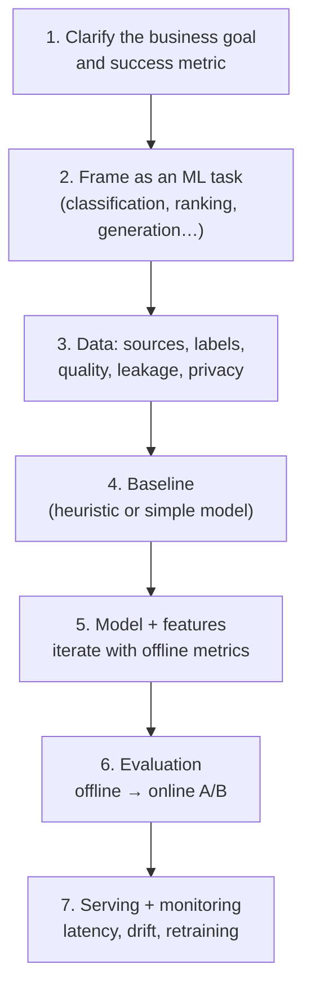

# AI Interviews: Roles & Rounds

[⬅ Back to index](../README.md)

Covers: the different AI roles (ML engineer, AI/LLM engineer, data scientist, applied/research scientist, MLOps), what each interview loop contains, how rounds are scored, how to talk about your projects, and how to prepare.

---

### 1. What are the main AI/ML roles, and how do their interviews differ?

Answer

| Role | What they do | Interview emphasis |
|---|---|---|
| **ML Engineer** | Builds, trains, deploys and maintains models in production | ML fundamentals, coding (DSA + ML coding), ML system design, MLOps |
| **AI / LLM Engineer** (GenAI engineer) | Builds products on top of foundation models: RAG, agents, fine-tuning, evaluation | LLM fundamentals, prompting, RAG, agents, evaluation, inference cost/latency, LLM system design, regular software engineering |
| **Data Scientist** | Analyses data, experiments, builds models for decisions | Statistics, probability, SQL, A/B testing, ML basics, product sense |
| **Applied Scientist** | Adapts research methods to product problems | Deep ML theory, modelling choices, papers, coding, ML design |
| **Research Scientist** | Advances the state of the art | Deep learning theory, math, research depth, publications, implementing papers |
| **MLOps / ML Platform Engineer** | Infrastructure for training, serving, monitoring | Distributed systems, Kubernetes, pipelines, GPUs, serving, observability |

Read the job description carefully: "AI Engineer" at one company means LLM application work, at another it means ML engineering.

### 2. What rounds does a typical ML/AI engineer loop include?

Answer

- **Coding (DSA)** – standard algorithm problems, usually in Python.
- **ML coding** – implement something from scratch: logistic regression with gradient descent, k-means, attention, a metric, a data-processing step. See [ML Coding](22-ml-coding.md).
- **ML fundamentals / breadth** – rapid questions across bias-variance, regularisation, metrics, trees, neural nets, transformers.
- **ML / AI system design** – design a recommender, a fraud model, a RAG assistant, an LLM-powered feature end to end. See [ML & GenAI System Design](20-ml-genai-system-design.md).
- **Domain depth** – NLP/LLMs, computer vision, recommendations, depending on the team.
- **Project deep dive** – one of your past projects, in detail.
- **Behavioral** – collaboration, ownership, ambiguity, failure.

LLM-application roles add rounds on **prompting, RAG, agents and evaluation**, sometimes as a take-home ("build a small RAG app and evaluate it").

### 3. How are AI interview answers scored?

Answer

Interviewers look for:
- **Correct fundamentals** – you know *why* things work (why L1 gives sparsity, why attention is scaled by √d).
- **Trade-off thinking** – accuracy vs latency vs cost; precision vs recall; RAG vs fine-tuning.
- **Practicality** – data quality, baselines first, evaluation before optimisation, monitoring in production.
- **Clear communication** – explain to a non-expert and to an expert.
- **Honesty** – saying "I'm not sure, but I'd reason like this" beats bluffing; AI moves fast and nobody knows everything.

### 4. How should you approach an open-ended ML problem in an interview?

Answer

The most common mistake is jumping to "I'd use a transformer" before defining the metric, the data and a baseline.

### 5. How do you present an ML/AI project in a deep-dive round?

Answer

1. **Problem and impact** – the business goal and the metric that mattered.
2. **Data** – where it came from, labelling, cleaning, biggest data problem.
3. **Approach** – baseline, what you tried, why the final model; key features or prompts.
4. **Evaluation** – offline metrics, how you avoided leakage, online results (A/B).
5. **Production** – serving setup, latency, cost, monitoring, retraining.
6. **What went wrong and what you learned.**

Expect follow-ups like "why not model X?", "how did you choose the threshold?", "how did you know it wasn't overfitting?". Only mention what you can defend.

### 6. What's different about interviewing for GenAI / LLM roles?

Answer

- Less emphasis on training models from scratch; more on **using foundation models well**: prompting, retrieval, tool use, fine-tuning when justified.
- **Evaluation** is central: how do you know your LLM feature works and doesn't regress?
- **Cost and latency** – tokens, caching, model choice, streaming.
- **Safety** – hallucinations, prompt injection, data leakage, guardrails.
- **Fast-moving knowledge** – interviewers often ask about recent models, techniques (reasoning models, MCP, agents) and your opinion on trade-offs. See [What's New](24-company-wise-whats-new.md).
- Strong **software engineering** is expected: these are product-building roles.

### 7. How much math do you need for AI interviews?

Answer

Depends on the role:
- **AI/LLM engineer** – intuition-level linear algebra (vectors, dot products, cosine similarity, matrix multiplication), probability (softmax, sampling), and the basics of gradients.
- **ML engineer / data scientist** – probability and statistics (Bayes, distributions, hypothesis testing), calculus for gradient descent and backprop, linear algebra (eigenvectors for PCA).
- **Research / applied scientist** – rigorous derivations (MLE, backprop by hand, optimisation theory).

See [Math & Statistics](02-math-statistics.md).

### 8. Which programming skills are expected?

Answer

- **Python** fluency: data structures, generators, typing, async for API-heavy LLM apps.
- **NumPy / pandas** for data manipulation and vectorised code.
- **PyTorch** (most common) or TensorFlow/JAX for model work: tensors, autograd, training loops, `Dataset`/`DataLoader`.
- **SQL** for data roles.
- Libraries for LLM work: model provider SDKs, Hugging Face Transformers, vector databases, evaluation tools.
- Software engineering basics: testing, APIs, Docker, Git.

### 9. What are common mistakes candidates make in AI interviews?

Answer

- Using buzzwords without understanding (saying "attention" without being able to explain Q, K, V).
- No baseline, no metric, no mention of data quality.
- Ignoring data leakage, class imbalance or distribution shift.
- Choosing accuracy as the metric for imbalanced problems.
- Proposing fine-tuning when prompting or RAG would do (or the reverse).
- Ignoring latency, cost and monitoring in system design.
- Not knowing how to evaluate an LLM feature.

### 10. How should you prepare for an AI interview in 2–4 weeks?

Answer

1. **Week 1** – fundamentals: topics 02–05 (math, ML basics, classical algorithms, metrics), plus daily coding practice.
2. **Week 2** – deep learning and transformers: topics 06–09; implement attention and a small training loop yourself.
3. **Week 3** – LLMs and GenAI: topics 10–18 (prompting, embeddings, RAG, fine-tuning, agents, evaluation, inference).
4. **Week 4** – production and design: topics 19–21, ML coding (22), scenarios (23), company prep (24), plus two mock ML system design interviews.

Build one small end-to-end project (e.g. a RAG app with an evaluation set) – it gives you concrete stories for every round.

---

[⬅ Back to index](../README.md) · [Next: Math & Statistics for ML ➡](02-math-statistics.md)
