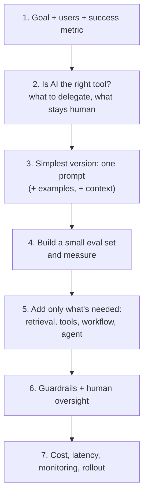

# AI Interviews: Roles & Rounds

[⬅ Back to index](../README.md)

Covers: the roles that use AI (AI engineer, applied AI engineer, AI-native developer, solutions engineer), what each interview loop contains, how answers are scored, how to talk about AI projects, and a preparation plan.

---

### 1. Which roles focus on using AI rather than building models, and what do they do?

Answer

| Role | What they do | Interview emphasis |
|---|---|---|
| **AI engineer / LLM application engineer** | Builds products on top of foundation models: prompts, RAG, tools, agents, evals | Prompting, context, tool use, RAG, agents, evals, guardrails, cost/latency, system design, solid software engineering |
| **Applied AI / solutions engineer** | Helps customers or internal teams design and ship AI solutions | Use-case scoping, prompting, architecture choices, evals, communication |
| **AI-native software engineer** (any engineering role today) | Uses AI coding assistants and agents daily to ship faster | Effective use of tools like Claude Code, reviewing AI output, testing, security |
| **AI product manager** | Decides what AI features to build and how to measure them | AI capabilities and limits, UX, evaluation, risk, cost |
| **Prompt / conversation designer** | Designs assistant behaviour, prompts and conversation flows | Prompt craft, evaluation, safety, tone |

These roles care about **how to get reliable, safe, cost-effective results from models** – not how to train them. (Model-building roles – ML engineers, research scientists – are a different track.)

### 2. What rounds does an AI engineer interview usually include?

Answer

- **Coding** – general software engineering, often practical (APIs, async code, data handling), sometimes with AI tools allowed.
- **AI fundamentals** – rapid questions on tokens, context windows, temperature, hallucinations, prompting, RAG, tool use, evals.
- **Build exercise / take-home** – e.g. build a small RAG or agent app with an evaluation set, then discuss trade-offs.
- **AI system design** – design an AI feature end to end: model choice, prompts, retrieval, tools, guardrails, evals, cost and latency. See [AI System Design](20-ai-system-design.md).
- **Scenarios** – "the chatbot hallucinates", "costs tripled", "the agent loops". See [Scenarios](21-scenario-based.md).
- **Project deep dive** and **behavioral** – what you built, how you measured it, what went wrong.

### 3. How are answers scored in AI-engineering interviews?

Answer

- **Practical judgement** – choosing the simplest approach that works (a good prompt before RAG, RAG before fine-tuning, a workflow before an agent).
- **Evaluation mindset** – every claim of "it works" is backed by an eval set and metrics.
- **Reliability and safety** – handling hallucinations, prompt injection, failures, human oversight.
- **Cost and latency awareness** – tokens, caching, model choice, streaming.
- **Clear communication** – explaining limitations honestly to users and stakeholders.

Naming frameworks or the newest model scores less than showing how you'd **measure and iterate**.

### 4. How should you approach an open-ended "build an AI feature for X" question?

Answer

The most common mistake is jumping straight to "I'd build a multi-agent system" without a metric, an eval set or a baseline prompt.

### 5. How do you present an AI project in a deep-dive round?

Answer

1. **Problem and impact** – the user problem and the metric that mattered.
2. **Approach** – the baseline prompt, what you added (retrieval, tools, workflow) and why.
3. **Evaluation** – how you built the eval set, how you graded, key numbers before/after.
4. **Failure modes** – hallucinations, edge cases, prompt injection – and how you handled them.
5. **Production** – cost per request, latency, caching, monitoring, rollout.
6. **What you'd do differently.**

Expect follow-ups like "how did you know it was better?" and "what happens when the model is wrong?".

### 6. How much do you need to know about how models work internally?

Answer

For AI-usage roles, enough to **predict behaviour and explain limitations**: tokens and context windows, next-token generation and sampling, why hallucinations happen, knowledge cutoffs, statelessness, what extended thinking does, and roughly how models are trained to follow instructions. You don't need to derive backpropagation or attention maths. See [How LLMs Work](02-how-llms-work.md).

### 7. What are common mistakes in AI-engineering interviews?

Answer

- Over-engineering (agents and fine-tuning for problems a good prompt solves).
- No evaluation plan ("I'd test it a bit").
- Ignoring cost and latency, or prompt injection and data privacy.
- Treating model output as correct without verification or human review where it matters.
- Vague prompting advice ("be clear") without concrete techniques (examples, XML structure, output formats).
- Not knowing the difference between workflows and agents, or RAG and fine-tuning.

### 8. How should you prepare in 2–4 weeks?

Answer

1. **Week 1** – foundations and prompting: topics 02–06; practise rewriting weak prompts.
2. **Week 2** – building: topics 07–11; build a small app with tool use and RAG.
3. **Week 3** – quality and operations: topics 12–17; add an eval set, guardrails, caching; use an AI coding assistant on a real project.
4. **Week 4** – topics 18–22, two mock AI system design interviews, and scenarios out loud.

The Anthropic Academy courses (AI Fluency, Building with the Claude API, Introduction to MCP, Claude Code in Action) cover much of this hands-on.

---

[⬅ Back to index](../README.md) · [Next: How LLMs Work (For People Who Use Them) ➡](02-how-llms-work.md)
