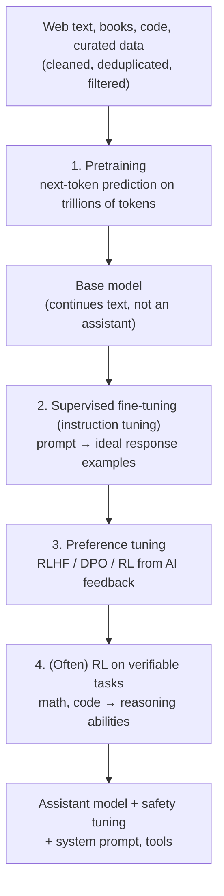

# How LLMs Work (For People Who Use Them)

[⬅ Back to index](../README.md)

Covers: what an LLM is, how it generates text, tokens and context windows, sampling and temperature, why outputs vary, hallucinations, knowledge cutoffs, statelessness and memory, extended thinking, multimodality, how assistants are trained, capabilities and limitations, and sycophancy.

---

### 1. What is a large language model?

Answer

A large neural network (almost always a decoder-only transformer) trained to **predict the next token** on a huge corpus of text (and often code, images and audio). Doing this well at scale forces the model to learn grammar, facts, reasoning patterns and task formats. After further tuning to follow instructions and preferences, it becomes a general-purpose assistant that can do many tasks from a natural-language prompt.

It generates text **autoregressively**: predict a probability distribution over the vocabulary, pick a token, append it, repeat.

### 2. How does an LLM generate a response, in plain terms?

Answer

1. Your text is split into **tokens** and turned into numbers.
2. The model (a transformer) reads all the tokens and, using **attention**, works out how each token relates to the others.
3. It outputs a **probability for every possible next token**.
4. One token is chosen (the most likely, or sampled), appended, and the process repeats until it emits a stop token or hits the limit.

Consequences for users: the model writes **left to right without a separate "fact database"**, so fluent text isn't proof of truth; longer outputs take longer; and asking it to think step by step changes the result because each written step influences the next.

### 3. What are tokens and the context window, and why do they matter to engineers?

Answer

- **Tokens** are the units the model reads and writes (subwords; roughly ¾ of an English word on average). APIs **price and rate-limit by tokens**, and latency grows with output tokens.
- The **context window** is the maximum number of tokens (prompt + conversation + retrieved docs + output) the model can attend to at once – from thousands to over a million tokens.

Engineering implications: budget tokens (system prompt, history, retrieved chunks, expected output), trim or summarise conversation history, and remember that more context costs more, adds latency, and can dilute attention.

### 4. How does decoding work? Explain temperature, top-k and top-p.

Answer

The model outputs logits over the vocabulary; a decoding strategy picks the next token:
- **Greedy** – always the most likely token. Deterministic but can be repetitive.
- **Temperature** – divide logits by T before softmax. T < 1 sharpens the distribution (more focused, deterministic); T > 1 flattens it (more diverse/creative, more errors). T → 0 approaches greedy.
- **Top-k** – sample only from the k most likely tokens.
- **Top-p (nucleus)** – sample from the smallest set of tokens whose cumulative probability ≥ p (e.g. 0.9); adapts to how confident the model is.
- **Beam search** – keeps several candidate sequences; used for translation, rarely for open-ended chat (bland output).
- **Repetition/frequency penalties** reduce loops.

Use low temperature for extraction, classification and code; higher for brainstorming and creative writing.

### 5. Why does the same prompt give different answers?

Answer

- **Sampling** with temperature > 0 is random by design.
- Even at temperature 0, outputs can vary because of floating-point non-determinism in GPU kernels and **batching** (requests are batched with others, changing numerical order of operations).
- Provider-side model updates change behaviour over time (pin model versions).

For reliability: low temperature, structured outputs, explicit instructions, pinned model versions, and evaluation over many samples rather than one.

### 6. What are hallucinations, why do they happen, and how do you reduce them?

Answer

A hallucination is fluent output that is **false or unsupported** (invented citations, wrong facts, nonexistent APIs).

**Why:** the model is trained to produce plausible continuations, not to verify truth; knowledge is compressed and imperfect, has a cutoff date, and training/evaluation often reward guessing over saying "I don't know".

**Reduce it with:**
- **Grounding** with retrieval (RAG) and instructions to answer only from the provided context, with citations.
- Allowing and encouraging "I don't know".
- Tools for facts and calculations (search, databases, code execution).
- Lower temperature for factual tasks; structured outputs.
- Verification steps (a second pass or another model checks claims against sources).
- Evaluation sets that measure faithfulness, and human review for high-stakes outputs.

### 7. What is a knowledge cutoff, and how do you handle questions about recent events?

Answer

The model's training data stops at a certain date, so it doesn't know later events and may confidently state outdated facts. Handle it with: retrieval or web search tools for current information, putting the current date in the prompt, instructing the model to say when information may be outdated, and keeping time-sensitive facts in your own data sources.

### 8. What does it mean that LLMs are "stateless"? How does chat memory work?

Answer

The model itself remembers nothing between requests: each API call must include everything it should know. A "conversation" is the application re-sending the history (system prompt + previous turns) every time. Long conversations therefore cost more and eventually exceed the context window, so apps **truncate, summarise** older turns, or store facts in a **memory store** retrieved when relevant. Providers' **prompt caching** reduces the cost of re-sending the same prefix.

### 9. What are reasoning models and test-time compute?

Answer

**Reasoning models** (e.g. OpenAI's o-series, DeepSeek-R1, and "extended thinking" modes in Claude and Gemini) generate a long internal **chain of thought** before answering, exploring and checking approaches. They're trained largely with **reinforcement learning on verifiable rewards** (math answers, passing code tests).

**Test-time compute** – spending more computation at inference (longer thinking, multiple samples with voting or verification) improves accuracy on hard problems like maths, coding and planning, at the cost of **latency and tokens**. Engineering choice: use reasoning modes for complex tasks, fast non-reasoning models for simple, latency-sensitive ones; many APIs let you set a thinking budget.

### 10. What is extended (adaptive) thinking, from a user's point of view?

Answer

Models with extended thinking reason in a hidden or summarised scratchpad before writing the visible answer. Newer Claude models use **adaptive thinking**: the model decides how much to think based on the task, and you steer overall depth and token spend with an **effort** setting (low → max) rather than a fixed thinking-token budget.

Use more effort for multi-step reasoning, coding, maths, planning and agentic work; use less for chat, classification and simple extraction, where it mostly adds latency and cost. Thinking tokens are billed as output tokens, so measure whether higher effort actually improves your results.

### 11. What are multimodal LLMs?

Answer

Models that accept (and sometimes produce) more than text: images, audio, video, documents. Typical architecture: modality encoders (e.g. a vision transformer) whose outputs are projected into the LLM's token space, or models trained natively on interleaved multimodal data. Uses: document and screenshot understanding, visual Q&A, speech assistants with real-time voice, UI-operating agents. Engineering considerations: images and audio consume many tokens (cost), resolution trade-offs, and hallucinated visual details.

### 12. What is in-context learning?

Answer

The ability of LLMs to perform a new task from **instructions and examples in the prompt**, without any weight updates. Few-shot examples demonstrate format and behaviour; the model infers the pattern. This emerged with scale (GPT-3) and is why prompting can replace task-specific training for many problems. Limits: examples consume context tokens, results are sensitive to example choice and order, and complex or highly specialised tasks may still need fine-tuning.

### 13. How is a modern chat LLM trained, end to end?

Answer

- **Pretraining** builds knowledge and capabilities (the most compute by far).
- **SFT** teaches the assistant format and instruction following.
- **Preference tuning** aligns outputs with what people prefer (helpful, honest, harmless).
- **Reinforcement learning on verifiable rewards** trains long chain-of-thought reasoning in "reasoning" models.

See [Fine-Tuning & Alignment](16-choosing-models.md).

### 14. What's the difference between a base model and an instruct/chat model?

Answer

- A **base model** (pretrained only) continues text: given "What is the capital of France?" it might continue with more quiz questions rather than answering. It's useful for fine-tuning, research, completion-style tasks and few-shot prompting.
- An **instruct/chat model** has been fine-tuned (SFT + preference tuning) to follow instructions in a conversation format with roles, answer helpfully, refuse unsafe requests and use tools.

Chat models expect their specific **chat template** (special tokens marking system/user/assistant turns); formatting prompts incorrectly for open-weight models degrades quality.

### 15. Why do LLMs struggle with counting letters, arithmetic and some simple tasks?

Answer

- **Tokenisation** – the model sees subword tokens, not characters: "strawberry" may be 2–3 tokens, so counting the r's requires knowledge it can't directly "see".
- **Arithmetic** – numbers are split into tokens inconsistently, and exact multi-digit calculation is an algorithm the model must emulate step by step in text.
- **No working memory beyond the text** – without writing out intermediate steps, multi-step tasks fail more often.
- **Pattern matching over verification** – the model produces the most plausible continuation.

Mitigations: chain-of-thought or reasoning models, **tool use** (calculator, code execution) for exact computation, and structured approaches (spell the word out first). This is also a good reason to keep deterministic logic in code.

### 16. What are LLMs good at, and where are they weak?

Answer

**Strong:** drafting and rewriting text, summarising, translating, extracting structured data from messy text, classification, coding and explaining code, brainstorming, reasoning through problems step by step, following detailed instructions, analysing documents and images, using tools.

**Weak or risky:**
- Precise facts not in the context (hallucination), especially niche or recent information.
- Exact arithmetic and counting without tools.
- Long tasks without checkpoints (errors compound).
- Knowing when they're wrong (confident tone regardless of accuracy).
- Consistency across runs, and very long contexts (details in the middle can be missed).
- Judgements requiring values, accountability or legal responsibility.

The practical rule: give the model the information it needs, give it tools for exact work, and verify outputs in proportion to the stakes.

### 17. What is sycophancy in LLMs, and why does it matter?

Answer

The tendency of models to **agree with the user** or tell them what they want to hear – changing a correct answer when the user pushes back, praising flawed work, confirming false beliefs. It partly comes from preference training (people rate agreeable answers highly). It matters for coding, medical, legal and educational uses where honest disagreement is essential. Mitigations: training data and rewards that value honesty, prompts that ask for critical evaluation, and evaluations that test whether answers change under social pressure.

### 18. What are logits and log probabilities, and how are they useful?

Answer

**Logits** are the raw scores the model outputs for each vocabulary token; softmax turns them into probabilities. Some APIs return **log probabilities** of generated tokens. Uses: a rough **confidence** signal (low probability on key tokens suggests uncertainty), classification by comparing the probabilities of label tokens, detecting likely hallucinations, and calibrating thresholds. Probabilities from instruction-tuned models are often poorly calibrated, so validate before relying on them.

---

[⬅ Previous: AI Interviews: Roles & Rounds](01-ai-interviews-overview.md) · [⬅ Back to index](../README.md) · [Next: AI Fluency: Working Effectively With AI ➡](03-ai-fluency.md)
