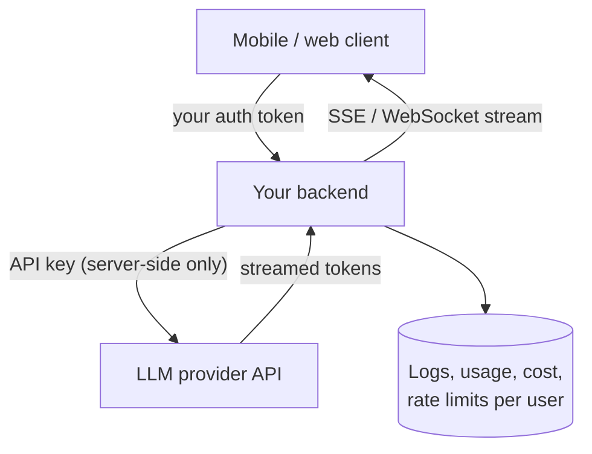

# Building With LLM APIs

[⬅ Back to index](../README.md)

Covers: how a chat API request works, roles and multi-turn conversations, system prompts, max tokens and stop reasons, streaming, errors, retries and rate limits, API key security, model versions, token counting, batch processing, effort and thinking controls, SDKs, cloud platforms, integrating an LLM into a mobile or web app, testing code that calls an LLM, and common first-time mistakes.

---

### 1. What does a typical LLM API request look like?

<details>
<summary>Answer</summary>

A request to a messages-style API (e.g. Claude's Messages API) contains:
- **model** – which model to use.
- **system** – instructions for the whole conversation.
- **messages** – the conversation as alternating `user` and `assistant` turns; content can be text, images, documents, tool calls and tool results.
- **max_tokens** – the maximum output length.
- Optional: **tools**, output format/schema, thinking or effort settings, streaming, metadata.

```python
import anthropic
client = anthropic.Anthropic()   # reads the API key from the environment

response = client.messages.create(
    model="claude-opus-5-5",
    max_tokens=1024,
    system="You are a concise assistant for a travel company.",
    messages=[{"role": "user", "content": "Suggest 3 weekend trips from Bengaluru."}],
)
print(response.content[0].text)
```

The response includes content blocks, a **stop reason** and **usage** (input/output token counts).

</details>

### 2. How do multi-turn conversations work with a stateless API?

<details>
<summary>Answer</summary>

The API remembers nothing between calls, so **your application stores the conversation** and sends the full history each time: append the user's message, call the API, append the assistant's response (all content blocks, not just the text), repeat. Consequences: long chats cost more per turn (mitigated by prompt caching and summarisation), you control what the model sees (you can trim or edit history), and you must persist conversations yourself if users expect to resume them.

</details>

### 3. What's the difference between the system prompt and user messages?

<details>
<summary>Answer</summary>

The **system prompt** sets persistent role, rules, tone, format and tool-use guidance for the whole conversation – it's where the application's (operator's) instructions go. **User messages** carry the end user's requests and data. Keep operator rules in the system prompt, keep user-supplied content in user turns (clearly delimited), and remember the system prompt isn't secret or tamper-proof – enforce critical rules in code too.

</details>

### 4. What are max_tokens and stop reasons?

<details>
<summary>Answer</summary>

- **max_tokens** caps output length. If the model hits it, the response is cut off mid-thought (`stop_reason: "max_tokens"`). Set it generously for long outputs (and stream them), tightly for short ones like classification.
- **Stop reasons** to handle: `end_turn` (finished), `max_tokens` (truncated), `tool_use` (wants a tool run), `stop_sequence` (hit a custom stop string), `pause_turn` (a long server-side tool turn paused – send it back to continue), `refusal` (declined by safety systems).

</details>

### 5. Why stream LLM responses, and how?

<details>
<summary>Answer</summary>

Generation takes seconds; streaming tokens as they're produced makes the app feel responsive (users start reading after TTFT). Implement with **Server-Sent Events** or WebSockets from the model server through your backend to the client; handle cancellation (stop generation when the user leaves, to save cost), partial-output rendering (markdown, code blocks), and errors mid-stream. Structured outputs can also be streamed and parsed incrementally.

</details>
### 6. How should an app handle API errors, retries and rate limits?

<details>
<summary>Answer</summary>

- **Retry** transient failures – 429 (rate limited), 5xx/overloaded, timeouts, connection errors – with **exponential backoff and jitter**, respecting `retry-after`. Official SDKs retry a few times by default.
- **Don't retry** 400-class request errors (invalid request, auth, not found) – fix the request.
- Catch **specific error types** rather than one generic catch-all, so you treat rate limits differently from bad requests.
- Queue or throttle requests to stay within your tokens-per-minute and requests-per-minute limits; spread batch work over time or use a batch API.
- Have a **fallback** (another model or a graceful message) for prolonged outages.

</details>

### 7. How do you keep API keys safe?

<details>
<summary>Answer</summary>

- Never put keys in client apps (mobile, browser) or source code – call the model **from your backend**.
- Store keys in a secrets manager or environment variables; rotate them; use separate keys per environment and service.
- Set **spend limits** and monitor usage per key to detect leaks.
- Prefer short-lived credentials/workload identity where your platform supports it.
- Scan repos for leaked keys (and revoke immediately if leaked).

</details>

### 8. Why pin model versions, and how do you upgrade safely?

<details>
<summary>Answer</summary>

Different model versions behave differently (style, verbosity, instruction following, API parameters). Use an explicit model ID, not a moving alias, in production. To upgrade: read the migration notes (some parameters change or are removed between generations), run your **eval suite** on the new model, review prompts written for older models (they may be over-prescriptive), compare cost and latency, and roll out gradually with monitoring. Track deprecation dates so you're not forced into a rushed migration.

</details>

### 9. How do you count tokens, and why does it matter?

<details>
<summary>Answer</summary>

Use the provider's **token-counting endpoint** or the `usage` field returned with each response – not a different provider's tokenizer, because tokenizers differ between model families (and even generations). Token counts drive cost, latency, context-window limits and rate limits; logging input, output and cached tokens per request is the basis of any cost analysis.

</details>

### 10. When should you use a batch API?

<details>
<summary>Answer</summary>

For **non-urgent, high-volume** work – evaluations, back-filling summaries, classifying a large backlog, generating embeddings or descriptions offline. Batch APIs process requests asynchronously (results within hours) at a significant discount (Claude's Message Batches are 50% off). Track each request by its custom ID because results can return in any order; handle per-request errors and expired items.

</details>

### 11. What do effort and thinking settings control?

<details>
<summary>Answer</summary>

On current Claude models, **adaptive thinking** lets the model decide how much to reason, and the **effort** setting (low, medium, high, xhigh, max) controls how thorough the model is and how many tokens it spends overall – including thinking, tool calls and verbosity of explanations. Lower effort suits chat, classification and high-volume routes; higher effort suits coding, complex analysis and long agentic tasks. Tune effort per route with evals rather than globally. (Older models used a fixed "thinking budget" in tokens instead.)

</details>

### 12. SDK vs raw HTTP – which should you use?

<details>
<summary>Answer</summary>

Use the **official SDK** for your language whenever one exists: it handles authentication, retries, timeouts, streaming helpers, typed request/response objects, typed errors and tool-use helpers, and tracks API changes. Use raw HTTP only for languages without an SDK or quick shell experiments. Avoid unofficial "compatible" wrappers for production – they lag behind features and can behave differently.

</details>

### 13. Can you use models through cloud platforms instead of the provider directly?

<details>
<summary>Answer</summary>

Yes – Claude, for example, is available directly via Anthropic's API and through Amazon Bedrock, Google Cloud Vertex AI and Microsoft Foundry. Reasons to use a cloud platform: existing cloud contracts and billing, data residency and networking within your cloud, and consolidated security/IAM. Trade-offs: some new features can arrive later or differ on some platforms, model IDs and client setup differ, and pricing may differ. Check feature availability for the platform you choose.

</details>

### 14. Write a minimal multi-turn chat loop.

<details>
<summary>Answer</summary>

```python
import anthropic
client = anthropic.Anthropic()
history = []

while True:
    user = input("You: ")
    if user in ("exit", "quit"):
        break
    history.append({"role": "user", "content": user})
    response = client.messages.create(
        model="claude-opus-5-5", max_tokens=2048,
        system="You are a helpful, concise assistant.",
        messages=history,
    )
    if response.stop_reason == "refusal":
        print("Assistant: Sorry, I can't help with that.")
        history.pop()
        continue
    history.append({"role": "assistant", "content": response.content})   # keep full content blocks
    print("Assistant:", "".join(b.text for b in response.content if b.type == "text"))
```

Talking points: the app owns history, full content blocks are appended, stop reasons are checked, and in production you'd add streaming, history trimming/summarisation, error handling and prompt caching.

</details>

### 15. How should a mobile or web app integrate an LLM feature?

<details>
<summary>Answer</summary>



- **Never call the provider directly from the app with your API key** – keys in apps can be extracted. Route through your backend (or a secure proxy).
- The backend adds the system prompt, context (user data, retrieved documents) and tools; enforces **per-user rate limits and quotas**; validates outputs; logs usage and cost.
- **Stream** the response to the client (SSE or WebSocket) and render partial markdown; cancel the request when the user leaves the screen.
- Handle errors and timeouts gracefully in the UI (retry, fallback message).
- Consider **on-device models** for small, private or offline features, with the cloud for complex ones.

</details>

### 16. How do you test code that calls an LLM?

<details>
<summary>Answer</summary>

Separate two concerns:
- **Your code's logic** – unit tests with the LLM client behind an interface and replaced by a **fake or mock** returning fixed responses (including tool calls, refusals, truncated output and errors). Test parsing, validation, retries and the tool loop deterministically.
- **The AI behaviour's quality** – an **eval suite** run against the real model on a set of inputs with graders (format checks, LLM judge, human review), run before releases and on prompt/model changes – not in every unit-test run (it's slow, costs money and is non-deterministic).

Recorded real responses can serve as regression fixtures for integration tests.

</details>

### 17. What are common mistakes engineers make when first adding an LLM to an app?

<details>
<summary>Answer</summary>

- Shipping the API key in the client.
- No limits – a single user (or attacker) runs up a huge bill.
- Parsing free text with regex instead of using structured outputs.
- Ignoring stop reasons (truncated or refused responses break the UI).
- No streaming – users stare at a spinner for 10 seconds.
- No evaluation – "it worked on my three examples".
- Trusting user input inside prompts (prompt injection) and model output inside actions (unsafe tool execution).
- Logging prompts with personal data and keeping them forever.

</details>

---

[⬅ Previous: Structured Outputs & Extraction](06-structured-outputs.md) · [⬅ Back to index](../README.md) · [Next: Tool Use (Function Calling) ➡](08-tool-use.md)
