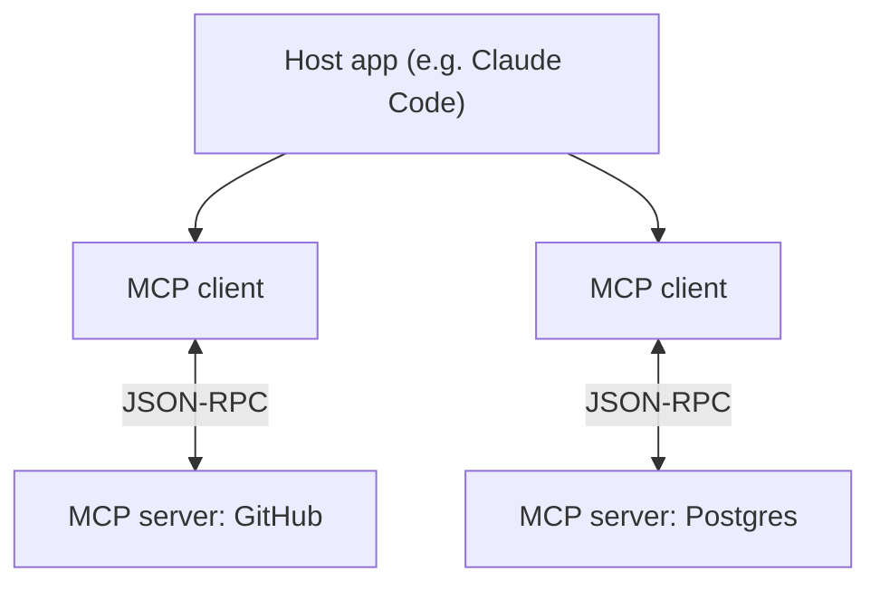

# Model Context Protocol (MCP)

[⬅ Back to index](../README.md)

Covers: what MCP is and why it exists, hosts, clients and servers, tools vs resources vs prompts, transports, building and testing a server, implementing a client, sampling, notifications and roots, authentication, MCP vs direct tools vs skills, remote servers in the API, and security.

---

### 1. What is the Model Context Protocol (MCP)?

<details>
<summary>Answer</summary>

An open protocol (introduced by Anthropic in late 2024 and since adopted widely across AI tools) that standardises how AI applications connect to external **tools, data and prompts**. An **MCP server** exposes capabilities – **tools** (actions), **resources** (readable data) and **prompts** (templates) – and any **MCP client** (a chat app, IDE, agent framework) can use them. It solves the N × M integration problem: build a GitHub or database connector once and it works across many AI apps.

Security considerations: only connect trusted servers, scope permissions and credentials tightly, beware of tool descriptions or results containing prompt injection, and require user approval for sensitive actions.

</details>
### 2. Explain MCP's architecture: hosts, clients and servers.

<details>
<summary>Answer</summary>

- **Host** – the AI application the user interacts with (Claude Desktop, Claude Code, an IDE, your own app).
- **Client** – a component inside the host that maintains a **one-to-one connection** with a server and speaks the protocol.
- **Server** – a program that exposes capabilities (tools, resources, prompts) for some system: GitHub, a database, a filesystem, an internal API.



Messages use JSON-RPC 2.0; on connect, client and server negotiate capabilities.

</details>

### 3. What's the difference between tools, resources and prompts in MCP?

<details>
<summary>Answer</summary>

| Primitive | Controlled by | Purpose | Example |
|---|---|---|---|
| **Tools** | The **model** decides to call them | Actions / computations | `create_issue`, `run_query` |
| **Resources** | The **application** decides what to load | Read-only data for context, addressed by URI | `file:///docs/readme.md`, `db://schema` |
| **Prompts** | The **user** chooses them (e.g. slash commands) | Reusable prompt templates with arguments | "Review this PR", "Summarise ticket {id}" |

Choosing the right primitive matters: data the app should attach (a document, a schema) fits a resource; something the model should decide to do fits a tool; a workflow a user triggers fits a prompt.

</details>

### 4. What transports does MCP support?

<details>
<summary>Answer</summary>

- **stdio** – the host launches the server as a local subprocess and talks over standard input/output. Simple, great for local tools (filesystem, local git), no network exposure.
- **Streamable HTTP** – the server runs as a web service (local or remote); requests over HTTP POST with optional streaming of responses/notifications. Used for remote/shared servers and SaaS integrations, typically with OAuth.

(An older HTTP + Server-Sent Events transport is being replaced by streamable HTTP.)

</details>

### 5. How do you build a simple MCP server?

<details>
<summary>Answer</summary>

With the official Python SDK's FastMCP helper:

```python
from mcp.server.fastmcp import FastMCP

mcp = FastMCP("docs")

@mcp.tool()
def search_docs(query: str, limit: int = 5) -> list[str]:
    """Search internal documentation and return matching titles."""
    return my_search(query)[:limit]

@mcp.resource("docs://{doc_id}")
def get_doc(doc_id: str) -> str:
    """Full text of a document by ID."""
    return load_doc(doc_id)

@mcp.prompt()
def summarise(doc_id: str) -> str:
    return f"Summarise document {doc_id} for a new team member in 5 bullets."

if __name__ == "__main__":
    mcp.run()          # stdio transport by default
```

Type hints and docstrings become the schemas and descriptions the model sees – write them carefully.

</details>

### 6. How do you test and debug an MCP server?

<details>
<summary>Answer</summary>

Use the **MCP Inspector** – a developer UI that connects to your server, lists its tools, resources and prompts, and lets you call them with test inputs and see raw responses. Then test inside a real host (e.g. add the server to Claude Code or Claude Desktop) to check the model picks and uses tools correctly. Log to stderr (not stdout) for stdio servers, since stdout carries the protocol.

</details>

### 7. What does an MCP client do in your own application?

<details>
<summary>Answer</summary>

It connects to one or more servers, lists their tools/resources/prompts, **converts tools into the model's tool format**, passes them to the model, and when the model calls one, forwards the call to the right server and returns the result in the next request. It also fetches resources when the app needs them and exposes prompts in the UI. Frameworks and agent SDKs often provide this, and some APIs (e.g. Claude's MCP connector) can connect to **remote** MCP servers directly from the API request.

</details>

### 8. What are sampling, notifications and roots in MCP?

<details>
<summary>Answer</summary>

- **Sampling** – lets a **server ask the client's model** to generate text (with user approval), so servers can use AI without their own API keys.
- **Notifications / progress / logging** – servers can send progress updates for long operations, log messages, and change notifications (e.g. the tool list changed).
- **Roots** – the client tells the server which locations (e.g. folders) it's allowed to work in, scoping filesystem access.
- **Elicitation** – a server can request structured input from the user mid-operation.

</details>

### 9. When should you use MCP vs defining tools directly vs skills?

<details>
<summary>Answer</summary>

- **Direct tool definitions in your API calls** – simplest for a single app with a few tools you own.
- **MCP** – when integrations should be **reusable across many hosts/apps**, maintained by another team or vendor, or exposed to tools like Claude Code and IDEs; also for standard auth and discovery.
- **Skills** – packaged **instructions, scripts and resources** that teach a model *how* to do a task (e.g. your company's report format) and load only when relevant. Skills and MCP complement each other: MCP provides access to systems; skills provide know-how.

</details>

### 10. What are the main security risks with MCP servers?

<details>
<summary>Answer</summary>

- **Untrusted servers** – a malicious server can expose misleading tools or exfiltrate data; install only trusted servers and pin versions.
- **Prompt injection** via tool descriptions or tool results.
- **Over-broad permissions** – tokens with more access than needed; prefer scoped OAuth.
- **Tool name collisions/shadowing** across servers.
- **Data exposure** – the model may move data from one server to another.

Mitigations: allow-lists of servers, least-privilege credentials, user approval for sensitive tools, sandboxing local servers, reviewing what each server can do, and monitoring tool calls.

</details>

---

[⬅ Previous: Tool Use (Function Calling)](08-tool-use.md) · [⬅ Back to index](../README.md) · [Next: RAG & Agentic Search ➡](10-rag-search.md)
