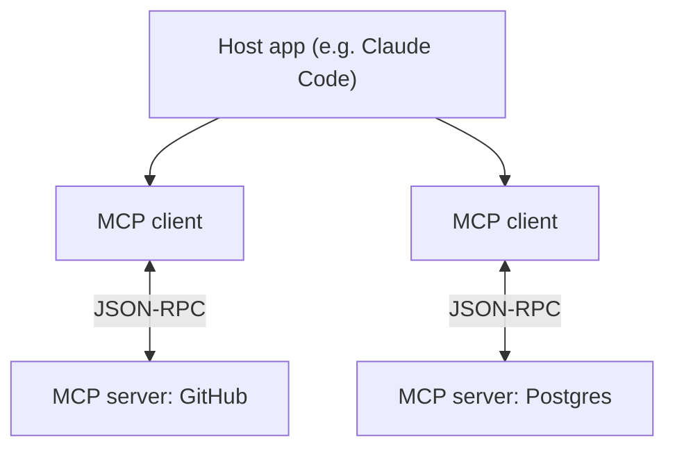
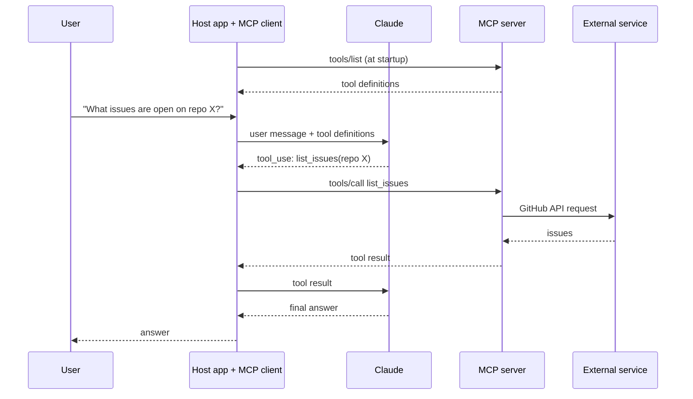

# Model Context Protocol (MCP)

[⬅ Back to index](../README.md)

Covers: what MCP is and the problem it solves, hosts/clients/servers, the end-to-end request flow, local vs remote servers, adding servers to apps, tools, resources and prompts in depth, building, testing and designing servers, implementing clients, JSON-RPC message types and the initialization handshake, stdio and StreamableHTTP transports, sessions and stateless scaling, sampling, progress and logging notifications, roots, elicitation, authentication, security, MCP vs direct tools vs skills, and troubleshooting.

---

## Fundamentals

### 1. What is the Model Context Protocol (MCP)?

<details>
<summary>Answer</summary>

An open protocol (introduced by Anthropic in late 2024 and since adopted widely across AI tools) that standardises how AI applications connect to external **tools, data and prompts**. An **MCP server** exposes capabilities – **tools** (actions), **resources** (readable data) and **prompts** (templates) – and any **MCP client** (a chat app, IDE, agent framework) can use them. It solves the N × M integration problem: build a GitHub or database connector once and it works across many AI apps.

Security considerations: only connect trusted servers, scope permissions and credentials tightly, beware of tool descriptions or results containing prompt injection, and require user approval for sensitive actions.

</details>

### 2. What problem does MCP solve compared with writing tool integrations yourself?

<details>
<summary>Answer</summary>

Without MCP, every AI application writes its own integration for every system: tool schemas, API calls, auth and error handling – for GitHub, Jira, Slack, databases and so on. That's an **N apps × M systems** problem, and the work is repeated by everyone. MCP moves that work into **reusable servers**: someone builds a GitHub MCP server once, and any MCP-compatible app (Claude Code, Claude Desktop, IDEs, your own app) can use it. Your application no longer has to define and execute those tools itself – it connects to the server, discovers what it offers, and forwards calls.

</details>

### 3. Explain MCP's architecture: hosts, clients and servers.

<details>
<summary>Answer</summary>

- **Host** – the AI application the user interacts with (Claude Desktop, Claude Code, an IDE, your own app).
- **Client** – a component inside the host that maintains a **one-to-one connection** with a server and speaks the protocol.
- **Server** – a program that exposes capabilities (tools, resources, prompts) for some system: GitHub, a database, a filesystem, an internal API.



Messages use JSON-RPC 2.0; on connect, client and server negotiate capabilities.

</details>

### 4. Walk through what happens end to end when a user asks something that needs an MCP tool.

<details>
<summary>Answer</summary>



The model never talks to the server directly: the **host's MCP client** lists tools, passes them to the model, executes the calls the model requests through the server, and returns results.

</details>

### 5. Local vs remote MCP servers – what's the difference?

<details>
<summary>Answer</summary>

- **Local servers** run on the user's machine, usually launched by the host over **stdio** – e.g. filesystem, local git, a local database. Simple, no network exposure, use local credentials.
- **Remote servers** run as web services reached over **StreamableHTTP** – e.g. a SaaS vendor's official server for its product. Shared by many users, updated centrally, and secured with **OAuth** so each user grants scoped access to their own account.

Remote servers are becoming the norm for SaaS integrations; local servers remain common for developer tools.

</details>

### 6. How do you add an MCP server to tools like Claude Code or Claude Desktop?

<details>
<summary>Answer</summary>

Hosts keep a list of configured servers: the command to launch a local (stdio) server with its arguments and environment variables, or the URL of a remote server. Claude Code has an `mcp` command (e.g. `claude mcp add …`) and supports project-level configuration that can be shared with the team; Claude Desktop uses a JSON config file and connector settings. After adding a server, the host lists its tools, resources and prompts – resources can be attached as context and prompts often appear as slash commands. Only add servers you trust, and give them the minimum credentials they need.

</details>

## Tools, Resources and Prompts

### 7. What's the difference between tools, resources and prompts in MCP?

<details>
<summary>Answer</summary>

| Primitive | Controlled by | Purpose | Example |
|---|---|---|---|
| **Tools** | The **model** decides to call them | Actions / computations | `create_issue`, `run_query` |
| **Resources** | The **application** decides what to load | Read-only data for context, addressed by URI | `file:///docs/readme.md`, `db://schema` |
| **Prompts** | The **user** chooses them (e.g. slash commands) | Reusable prompt templates with arguments | "Review this PR", "Summarise ticket {id}" |

Choosing the right primitive matters: data the app should attach (a document, a schema) fits a resource; something the model should decide to do fits a tool; a workflow a user triggers fits a prompt.

</details>

### 8. How do MCP tools work in more detail?

<details>
<summary>Answer</summary>

The client discovers tools with **`tools/list`** (name, description, JSON input schema, optional output schema) and invokes them with **`tools/call`**. Results contain content (text, images, or links to resources) and can flag errors so the model can recover. Tools can include **annotations** – hints such as read-only or destructive – that hosts can use to decide when to ask the user for confirmation. Servers can notify clients when their tool list changes. Because the model decides when to call tools, their descriptions matter as much as in any tool-use setup.

</details>

### 9. How do MCP resources work, and what are direct vs templated resources?

<details>
<summary>Answer</summary>

Resources expose **read-only data** identified by URIs. The client lists them (`resources/list`) and reads them (`resources/read`), getting content with a **MIME type** (e.g. `application/json`, `text/plain`) that it handles accordingly.
- **Direct resources** have fixed URIs – e.g. `docs://index` returning a list of documents.
- **Templated resources** have parameters in the URI – e.g. `docs://{doc_id}` – so one definition covers many items.

Because the **application** decides when to read resources, they're ideal for things like letting a user attach a document ("@report.pdf") or injecting a database schema as context, without the model having to call a tool. Clients can also subscribe to updates for resources that change.

</details>

### 10. How do MCP prompts work, and where do users see them?

<details>
<summary>Answer</summary>

Prompts are **reusable, high-quality prompt templates** a server provides, optionally with arguments: e.g. "summarise_ticket(ticket_id)" or "format_document(doc_id)". The client lists them (`prompts/list`) and fetches a filled-in version (`prompts/get`), which becomes messages sent to the model. Hosts typically expose them to **users** as slash commands or menu items, sometimes with argument **autocomplete** provided by the server. They let the people who know a system best package the best way to ask about it.

</details>

## Building Servers and Clients

### 11. How do you build a simple MCP server?

<details>
<summary>Answer</summary>

With the official Python SDK's FastMCP helper:

```python
from mcp.server.fastmcp import FastMCP

mcp = FastMCP("docs")

@mcp.tool()
def search_docs(query: str, limit: int = 5) -> list[str]:
    """Search internal documentation and return matching titles."""
    return my_search(query)[:limit]

@mcp.resource("docs://{doc_id}")
def get_doc(doc_id: str) -> str:
    """Full text of a document by ID."""
    return load_doc(doc_id)

@mcp.prompt()
def summarise(doc_id: str) -> str:
    return f"Summarise document {doc_id} for a new team member in 5 bullets."

if __name__ == "__main__":
    mcp.run()          # stdio transport by default
```

Type hints and docstrings become the schemas and descriptions the model sees – write them carefully.

</details>

### 12. Why do type hints and descriptions matter so much when defining MCP tools?

<details>
<summary>Answer</summary>

With SDKs like the Python one, the **function signature, type hints and docstrings/field descriptions become the tool's schema and description** that the model sees – you don't hand-write JSON schemas. So:
- Use precise types (enums, ints with ranges, required vs optional).
- Describe each parameter (e.g. with Pydantic `Field(description=...)`) – what it is, its format, examples.
- Write the tool docstring as guidance: what it does, when to use it, what it returns.

Vague names and descriptions lead to wrong tool choices and malformed arguments, which no amount of server logic can fix.

</details>

### 13. How do you test and debug an MCP server?

<details>
<summary>Answer</summary>

Use the **MCP Inspector** – a developer UI that connects to your server, lists its tools, resources and prompts, and lets you call them with test inputs and see raw responses. Then test inside a real host (e.g. add the server to Claude Code or Claude Desktop) to check the model picks and uses tools correctly. Log to stderr (not stdout) for stdio servers, since stdout carries the protocol.

</details>

### 14. What does an MCP client do in your own application?

<details>
<summary>Answer</summary>

It connects to one or more servers, lists their tools/resources/prompts, **converts tools into the model's tool format**, passes them to the model, and when the model calls one, forwards the call to the right server and returns the result in the next request. It also fetches resources when the app needs them and exposes prompts in the UI. Frameworks and agent SDKs often provide this, and some APIs (e.g. Claude's MCP connector) can connect to **remote** MCP servers directly from the API request.

</details>

### 15. What makes a well-designed MCP server?

<details>
<summary>Answer</summary>

- **Focused scope** – a coherent set of capabilities for one system, not dozens of thin wrappers around every API endpoint.
- **Task-shaped tools** – e.g. `create_issue_with_labels` rather than forcing the model to chain five low-level calls.
- **The right primitive** – data as resources, actions as tools, workflows as prompts.
- **Concise, useful results** – return what the model needs, paginate large results, include IDs it can use next.
- **Clear errors** the model can act on.
- **Safe defaults** – read-only where possible, annotations for destructive actions, scoped credentials.
- **Tested** with the inspector and in real hosts with real prompts.

</details>

## Communication and Transports

### 16. What message types does MCP use?

<details>
<summary>Answer</summary>

MCP uses **JSON-RPC 2.0** messages, in both directions:
- **Requests** – have an `id` and a `method` (e.g. `tools/call`) and expect a response.
- **Results / errors** – responses matched to a request by its `id`.
- **Notifications** – have a `method` but no `id`, and expect no response (e.g. progress updates, log messages, "tool list changed").

Communication is **bidirectional**: clients send requests to servers (list tools, call a tool), and servers can send requests to clients (sampling, elicitation, listing roots).

</details>

### 17. What happens during MCP connection initialization?

<details>
<summary>Answer</summary>

1. The client sends an **`initialize` request** with the protocol version it supports, its capabilities (e.g. sampling, roots) and client info.
2. The server replies with its protocol version, **its capabilities** (tools, resources, prompts, logging…) and server info.
3. The client sends an **`initialized` notification**, and normal operation begins.

This **capability negotiation** means each side only uses features the other supports – e.g. a server won't send sampling requests to a client that didn't declare sampling.

</details>

### 18. What transports does MCP support?

<details>
<summary>Answer</summary>

- **stdio** – the host launches the server as a local subprocess and talks over standard input/output. Simple, great for local tools (filesystem, local git), no network exposure.
- **Streamable HTTP** – the server runs as a web service (local or remote); requests over HTTP POST with optional streaming of responses/notifications. Used for remote/shared servers and SaaS integrations, typically with OAuth.

(An older HTTP + Server-Sent Events transport is being replaced by streamable HTTP.)

</details>

### 19. How does the stdio transport work?

<details>
<summary>Answer</summary>

The host **launches the server as a subprocess** and exchanges newline-delimited JSON-RPC messages over the process's **stdin and stdout**. It's simple, fast and private (no network), and fully bidirectional, so servers can send requests and notifications back to the client. The catch for developers: **stdout is reserved for protocol messages** – any stray `print` breaks the connection, so logs must go to stderr. The server lives only as long as the host runs it, and it serves one client.

</details>

### 20. How does the StreamableHTTP transport work?

<details>
<summary>Answer</summary>

The server exposes **one HTTP endpoint**:
- The client sends each JSON-RPC message as an **HTTP POST**.
- The server answers either with a plain **JSON response**, or by opening a **Server-Sent Events (SSE) stream** for that request so it can send progress notifications and then the result.
- The client can also open an SSE stream (via GET) so the server can send **server-initiated** messages (like sampling requests) outside a specific request.
- A **session ID** header ties requests together when the server keeps per-session state.

It works across networks, supports many clients, and fits standard web infrastructure (load balancers, auth, TLS).

</details>

### 21. How do sessions and state affect scaling a remote MCP server?

<details>
<summary>Answer</summary>

A **stateful** StreamableHTTP server keeps per-session state (the session ID, open SSE streams, pending server-to-client requests) in memory on one instance – so requests from a session must reach that same instance (sticky routing), which complicates horizontal scaling.

A **stateless** configuration treats every request independently, so any instance behind a load balancer can serve it – much easier to scale. The trade-off: features that need a persistent channel back to the client (server-initiated requests such as sampling, or streaming notifications outside a request) may be limited or unavailable, and some SDK settings (e.g. returning plain JSON instead of SSE streams) also remove streaming progress. Choose based on which features the server needs.

</details>

### 22. How do you choose between stdio and StreamableHTTP?

<details>
<summary>Answer</summary>

- **stdio** – local tools for one user on one machine (filesystem, local git, CLI wrappers, local databases); simplest to build; no auth layer needed.
- **StreamableHTTP** – shared or hosted servers, SaaS integrations, many users, remote access, central updates; needs auth (OAuth), TLS and operational care.
- For remote servers, decide **stateful vs stateless** by whether you need server-initiated features (sampling, rich notifications) vs easy horizontal scaling.

</details>

## Advanced Features

### 23. What is sampling in MCP, and why is it useful?

<details>
<summary>Answer</summary>

**Sampling** lets a **server ask the client to run an LLM call** on its behalf (`sampling/createMessage`): the server sends messages and preferences, the client calls its own model (typically with the user able to review or approve), and returns the result.

Why it matters: a server can use AI – e.g. summarise a document it fetched, or classify data – **without its own model provider, API keys or AI costs**; the cost and model choice stay with the client and user. It's also how servers can build agent-like behaviour while the user stays in control of model usage.

</details>

### 24. How do logging and progress notifications work in MCP?

<details>
<summary>Answer</summary>

For long-running operations, servers send **notifications** back to the client while still working:
- **Progress notifications** – tied to a progress token from the request, reporting progress (e.g. "40 of 100 files processed") so the host can show a progress bar.
- **Log messages** – info/warning/error messages the host can display or record.

In the Python SDK, a tool can receive a **context object** and call methods to log and report progress. These keep users informed and help debugging; they need a transport/setup that can stream messages back during a request.

</details>

### 25. What are roots in MCP?

<details>
<summary>Answer</summary>

**Roots** are locations (usually `file://` directories) that the **client tells the server it may work within** – e.g. the project folder open in the IDE. The server can request the list of roots and gets notified if they change. A well-behaved server (say, a filesystem or code-search server) resolves paths against the roots and **refuses access outside them**, creating a permission boundary chosen by the user. Note that enforcement is done by the server's code – roots are only as strong as the server's checks, which is another reason to use trusted servers.

</details>

### 26. What is elicitation in MCP?

<details>
<summary>Answer</summary>

A feature that lets a server **ask the user for structured input mid-operation** through the client – e.g. "Which repository should I create this issue in?" or a confirmation with a few fields defined by a schema. The host shows the request to the user, who can provide the input, decline or cancel. It enables interactive workflows without the server guessing. Servers shouldn't use it to request sensitive information like passwords.

</details>

## Security and Ecosystem

### 27. How does authentication work for remote MCP servers?

<details>
<summary>Answer</summary>

Remote servers use **OAuth**-based authorisation: when a user connects the server in a host, they're redirected to sign in with the service and grant **scoped** permissions; the client then sends access tokens with its requests. This means each user's access is limited to their own data and permissions, tokens can be revoked, and no shared API key is embedded in the host. Local stdio servers usually get credentials from environment variables configured by the user – keep those scoped and out of shared config files.

</details>

### 28. What are the main security risks with MCP servers?

<details>
<summary>Answer</summary>

- **Untrusted servers** – a malicious server can expose misleading tools or exfiltrate data; install only trusted servers and pin versions.
- **Prompt injection** via tool descriptions or tool results.
- **Over-broad permissions** – tokens with more access than needed; prefer scoped OAuth.
- **Tool name collisions/shadowing** across servers.
- **Data exposure** – the model may move data from one server to another.

Mitigations: allow-lists of servers, least-privilege credentials, user approval for sensitive tools, sandboxing local servers, reviewing what each server can do, and monitoring tool calls.

</details>

### 29. When should you use MCP vs defining tools directly vs skills?

<details>
<summary>Answer</summary>

- **Direct tool definitions in your API calls** – simplest for a single app with a few tools you own.
- **MCP** – when integrations should be **reusable across many hosts/apps**, maintained by another team or vendor, or exposed to tools like Claude Code and IDEs; also for standard auth and discovery.
- **Skills** – packaged **instructions, scripts and resources** that teach a model *how* to do a task (e.g. your company's report format) and load only when relevant. Skills and MCP complement each other: MCP provides access to systems; skills provide know-how.

</details>

### 30. Can you use MCP servers directly from the Claude API?

<details>
<summary>Answer</summary>

Yes – the Claude API's **MCP connector** lets a request reference **remote MCP servers by URL**, and the API connects to them and makes their tools available to the model, without you writing an MCP client. It suits remote (HTTP) servers; for local stdio servers or full control over the protocol, implement a client with the MCP SDK in your own application. Managed agent platforms and agent SDKs also support MCP servers as a standard way to add tools.

</details>

### 31. What are common problems when an MCP server doesn't work, and how do you fix them?

<details>
<summary>Answer</summary>

- **Server doesn't start / not found** – wrong command or path, missing runtime, missing dependencies; run the same command in a terminal.
- **Connection drops immediately (stdio)** – something printed to stdout; log to stderr instead.
- **Missing credentials** – environment variables not passed to the server process.
- **Tools don't appear** – initialization or capability errors; check host logs and test with the MCP Inspector.
- **Model never uses the tool** – vague descriptions or overlapping tools; improve names and descriptions.
- **Timeouts** – slow operations without progress notifications; speed them up, paginate, or report progress.

</details>

---

[⬅ Previous: Tool Use (Function Calling)](08-tool-use.md) · [⬅ Back to index](../README.md) · [Next: RAG & Agentic Search ➡](10-rag-search.md)
