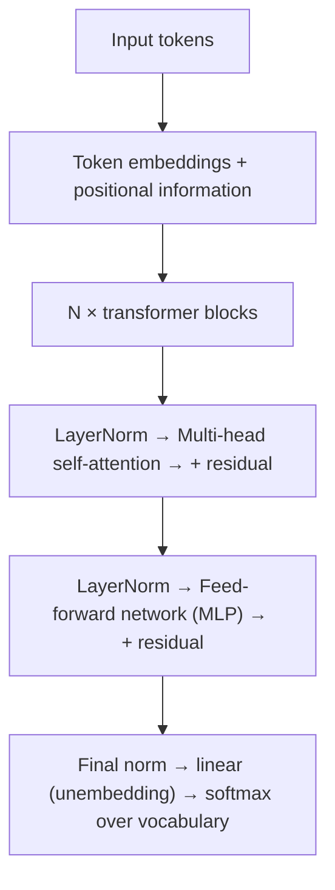

# Transformers Deep Dive

[⬅ Back to index](../README.md)

Covers: the transformer architecture, self-attention step by step, Q/K/V, scaling by √d, multi-head attention, causal masking, positional encodings (sinusoidal, learned, RoPE, ALiBi), the feed-forward block, encoder vs decoder vs encoder-decoder, attention complexity, KV cache, FlashAttention, MQA/GQA, mixture of experts, parameter counting and long-context techniques.

---

### 1. Describe the transformer architecture at a high level.

Answer

Each block has two sub-layers: **multi-head self-attention** (tokens exchange information) and a position-wise **feed-forward network** (each token's representation is transformed independently), each wrapped with normalisation and a **residual connection**. Unlike RNNs, all positions are processed **in parallel** during training, which made scaling to huge datasets practical.

### 2. Explain self-attention step by step.

Answer

For each token embedding `x`, compute three vectors with learned matrices: **query** `q = xW_Q`, **key** `k = xW_K`, **value** `v = xW_V`.
1. Score every pair: `qᵢ · kⱼ` (how relevant token j is to token i).
2. Scale by `1/√d_k`.
3. Apply **softmax** over j to get attention weights summing to 1.
4. Output for token i = weighted sum of the values `Σ wᵢⱼ vⱼ`.

In matrix form: `Attention(Q, K, V) = softmax(QKᵀ / √d_k) · V`.

Intuition: the query is "what I'm looking for", the key is "what I contain", the value is "what I'll pass on if selected". Each token builds a new representation by gathering information from the tokens most relevant to it.

### 3. Why divide by √d_k in attention?

Answer

If query and key components are roughly independent with unit variance, their dot product has variance `d_k`, so for large dimensions the scores get large in magnitude. Large inputs push softmax into saturated regions (one weight ≈ 1, the rest ≈ 0) where **gradients are tiny**, slowing learning. Dividing by `√d_k` keeps the score variance around 1.

### 4. What is multi-head attention and why use several heads?

Answer

Instead of one attention with full dimension, the model runs **h heads in parallel**, each with its own smaller Q/K/V projections (dimension `d_model / h`), then concatenates their outputs and projects back. Different heads can specialise in different relationships (syntax, coreference, nearby tokens, long-range links) at roughly the same compute cost as a single full-width head.

### 5. What is causal masking, and why do decoder models need it?

Answer

In a decoder (GPT), token i must not see tokens after it, otherwise training on next-token prediction would be trivially cheating. A **causal mask** sets scores for future positions to −∞ before the softmax, so their weights become 0. This also makes training efficient: one forward pass over a sequence gives a next-token prediction **at every position** at once (teacher forcing).

### 6. Why do transformers need positional encodings? Compare the main approaches.

Answer

Self-attention is **permutation-invariant** – without position information, "dog bites man" and "man bites dog" look the same. Approaches:
- **Sinusoidal** (original paper) – fixed sine/cosine functions of position added to embeddings.
- **Learned absolute** embeddings (BERT, GPT-2) – limited to the trained maximum length.
- **RoPE (rotary position embeddings)** – rotates query and key vectors by an angle proportional to position, so their dot product depends on **relative distance**. Used by most modern LLMs (LLaMA family and many others); context can be extended by scaling the rotation frequencies (position interpolation, NTK scaling, YaRN).
- **ALiBi** – adds a distance-proportional penalty to attention scores; extrapolates to longer sequences.

### 7. What does the feed-forward network in each block do?

Answer

A two-layer MLP applied to each token independently, usually expanding the dimension ~4× (e.g. 4,096 → 16,384 → 4,096) with a non-linearity (GELU, or **SwiGLU** in modern LLMs). Attention mixes information **between** tokens; the FFN transforms information **within** each token. FFN layers hold about two-thirds of a dense transformer's parameters and are thought to store much of the model's factual knowledge.

### 8. Encoder-only vs decoder-only vs encoder-decoder transformers?

Answer

- **Encoder-only** (BERT, RoBERTa) – bidirectional attention; best for understanding tasks, embeddings, classification, rerankers.
- **Decoder-only** (GPT, LLaMA, Claude, Gemini-style LLMs) – causal attention, next-token prediction; general-purpose generation; simple to scale and the dominant design for LLMs.
- **Encoder-decoder** (T5, BART, original transformer) – the encoder reads the input bidirectionally, the decoder generates with **cross-attention** to the encoder outputs; natural for translation and summarisation.

### 9. What is the computational complexity of attention, and why does it matter?

Answer

For sequence length n and dimension d, computing `QKᵀ` costs **O(n²·d)** time and the attention matrix needs **O(n²)** memory. Doubling the context quadruples attention cost, which is why long contexts are expensive. Mitigations:
- **FlashAttention** – exact attention computed in tiles that stay in fast on-chip GPU memory, avoiding materialising the n×n matrix; big speed and memory gains.
- **Sparse / local / sliding-window attention** (Longformer, Mistral's sliding window).
- **Linear-attention and state-space models** (e.g. Mamba) with linear scaling, sometimes in hybrids with attention layers.
- Retrieval (RAG) instead of putting everything in the context.

### 10. What is the KV cache?

Answer

During autoregressive generation, each new token attends to all previous tokens. Their **keys and values don't change**, so instead of recomputing them every step, the model caches them and only computes Q, K, V for the new token. This turns per-token cost from re-processing the whole sequence into processing one token.

Cost: KV cache memory = `2 × layers × KV heads × head_dim × sequence length × batch × bytes per value`, which can exceed the model weights for long contexts and big batches. It's the main memory bottleneck in LLM serving – hence **GQA/MQA**, **KV cache quantisation**, and **paged attention** (vLLM). See [LLM Inference](17-llm-inference-serving.md).

### 11. What are multi-query attention (MQA) and grouped-query attention (GQA)?

Answer

- **Multi-head attention** – every head has its own keys and values.
- **MQA** – all query heads **share one** key/value head: the KV cache shrinks by the number of heads, speeding inference, with some quality loss.
- **GQA** – a middle ground: query heads are split into groups that share K/V heads (e.g. 32 query heads, 8 KV heads). Near-MHA quality with much smaller KV cache; used by most modern open LLMs.
- **Multi-head latent attention (MLA)**, used in DeepSeek models, compresses keys and values into a small latent vector for an even smaller cache.

### 12. What is a mixture-of-experts (MoE) model?

Answer

The feed-forward layer is replaced by many **expert** FFNs and a **router** that sends each token to only the top-k experts (e.g. 2 of 8, or 8 of 256). The model has a huge **total** parameter count but only a fraction is **active** per token, so compute per token stays low (e.g. Mixtral, DeepSeek-V3, and many frontier models are reported to use MoE).

Trade-offs: more capacity per FLOP and faster training for a given quality, but all experts must sit in memory, routing needs **load-balancing** to avoid some experts being overused, and serving requires expert parallelism across GPUs.

### 13. How do you count the parameters of a transformer?

Answer

Rough rule for a dense decoder: **≈ 12 · L · d²** parameters, where L = layers and d = model dimension (4d² for the Q, K, V and output projections in attention + 8d² for an FFN with 4× expansion), plus embeddings `V · d` for vocabulary V.

Example: L = 32, d = 4,096 → 12 × 32 × 16.8M ≈ 6.4B, plus embeddings (32K × 4,096 ≈ 0.13B) → ~6.5–7B, consistent with 7B-class models (exact numbers vary with GQA and SwiGLU).

Memory for weights: params × bytes (7B × 2 bytes in BF16 ≈ 14 GB; ≈ 3.5–4 GB at 4-bit).

### 14. What is cross-attention?

Answer

Attention where **queries come from one sequence and keys/values from another**. In encoder-decoder models, decoder tokens attend to encoder outputs (the translation attends to the source sentence). In text-to-image diffusion models, image features attend to text embeddings, which is how the prompt steers generation. In some multimodal models, text tokens cross-attend to image features.

### 15. How do LLMs handle very long contexts (128K–1M+ tokens)?

Answer

- Efficient attention kernels (FlashAttention) and memory-saving KV caches (GQA, quantised caches).
- **Position extension** – RoPE scaling (YaRN, NTK-aware), then continued training on long sequences.
- Sliding-window or hybrid attention layers; sequence/context parallelism across GPUs for training.
- Careful long-context training data.

Caveat: a large window doesn't guarantee good use of it – models can miss information in the middle ("lost in the middle"), so evaluate with needle-in-a-haystack and realistic long-document tasks, and still consider RAG for cost and precision.

### 16. Why did transformers replace RNNs?

Answer

- **Parallel training** over all positions (RNNs are sequential), making it practical to train on trillions of tokens with GPUs.
- **Direct long-range connections** – any token can attend to any other in one step, instead of passing information through many recurrent steps.
- They **scale predictably**: more data, parameters and compute keep improving quality (scaling laws).

Their weakness is the quadratic cost of attention in sequence length, which is driving research into linear-time alternatives and hybrids.

### 17. What are state-space models (Mamba), and why are they interesting?

Answer

**State-space models** process sequences with a recurrent-style hidden state updated by learned linear dynamics, but can be trained in parallel like convolutions. **Mamba** made the state updates **input-dependent (selective)**, letting the model decide what to remember or forget.

Benefits: **linear time** in sequence length and constant memory per generated token (no growing KV cache), so they're attractive for very long sequences and fast inference. Weaknesses: exact recall of specific earlier tokens (copying, lookup) is harder than with attention. Many recent models are **hybrids** that mix a few attention layers with state-space or linear-attention layers to get most of the efficiency with attention's recall ability.

---

[⬅ Previous: NLP & Sequence Models](08-nlp-sequence-models.md) · [⬅ Back to index](../README.md) · [Next: LLM Fundamentals ➡](10-llm-fundamentals.md)
