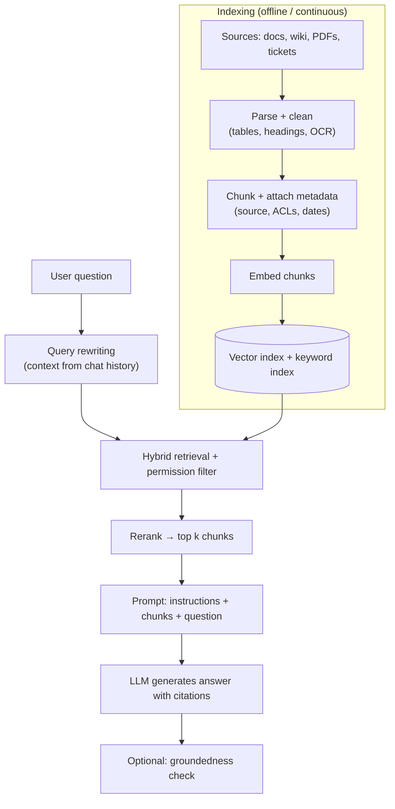

# RAG & Agentic Search

[⬅ Back to index](../README.md)

Covers: what RAG is, the pipeline, embeddings at a practical level, chunking, document parsing, lexical (BM25) vs semantic search, hybrid search and reranking, contextual retrieval, citations, permissions, evaluation, failure modes, agentic search, RAG vs fine-tuning vs long context, and scaling.

---

### 1. What is RAG and why use it?

Answer

**Retrieval-Augmented Generation** retrieves relevant information from your own data at query time and puts it into the LLM's prompt, so the model answers **grounded** in that information.

Why:
- The model doesn't know your **private or recent** data.
- **Reduces hallucinations** and enables **citations**.
- Knowledge is updated by updating the index – no retraining.
- **Access control** can be enforced at retrieval time.
- Cheaper than stuffing whole document sets into every prompt.

### 2. Walk through a typical RAG pipeline.

Answer

Each stage can fail independently, so evaluate retrieval and generation separately.

### 3. What is an embedding?

Answer

A dense vector (typically 256–4,096 numbers) produced by a model so that **semantically similar inputs are close together**. Texts, images, users, products and code can all be embedded. Uses: semantic search, RAG retrieval, recommendations, clustering, deduplication, classification features and anomaly detection. Unlike keyword matching, embeddings match meaning ("cheap flights" ≈ "low-cost airfare").

### 4. How do you choose an embedding model?

Answer

- **Quality on your data** – build a small retrieval test set (queries + relevant documents) and measure recall@k; public leaderboards like MTEB are a starting point only.
- **Domain and language** – multilingual? code? legal/medical?
- **Dimensions** – larger vectors cost more storage and search time.
- **Max input length** – affects chunk size.
- **Cost and latency** – API vs self-hosted; embedding millions of documents adds up.
- **Stability** – changing the model means **re-embedding everything** (vectors from different models aren't comparable).

### 5. How do you chunk documents, and why does chunking matter?

Answer

Chunks are the unit of retrieval: too large → diluted embeddings and wasted context; too small → missing context, fragmented answers.

Strategies:
- **Fixed-size** with overlap (e.g. 300–800 tokens, 10–20% overlap) – simple baseline.
- **Structure-aware** – split on headings, sections, paragraphs; keep tables and code blocks intact.
- **Semantic chunking** – split where embedding similarity between sentences drops.
- **Parent-child / small-to-big** – retrieve small precise chunks, but pass their larger parent section to the LLM.
- **Contextual chunk headers** – prepend the document title/section path (or an LLM-written summary of the chunk's context) to each chunk before embedding.

Tune chunk size on your evaluation set; there's no universal best.

### 6. Why is document parsing often the hardest part?

Answer

Real documents are messy: PDFs with multi-column layouts, tables, headers/footers, scanned pages, charts, slides and spreadsheets. Bad parsing (merged columns, broken tables, lost headings) produces bad chunks that no retriever can fix. Use layout-aware parsers or OCR, convert tables to structured text (markdown/JSON), keep heading hierarchy as metadata, and consider multimodal models for complex pages (or embedding page images). Inspect parsed output manually on a sample – it's usually the highest-leverage fix.

### 7. What is BM25 (lexical search), and why still use it alongside embeddings?

Answer

BM25 ranks documents by **keyword matches**, weighting rare terms higher (inverse document frequency) and saturating repeated terms, with document-length normalisation. It excels at exact matches – product codes, error messages, names, acronyms – which embeddings can miss. Embeddings excel at meaning and paraphrases. Running both and merging results (**hybrid search**, e.g. with reciprocal rank fusion) is consistently better than either alone.

### 8. What is hybrid search and why use it?

Answer

Combining **keyword search (BM25)** and **vector search**. Embeddings capture meaning but can miss exact terms (product codes, names, error messages, rare jargon); BM25 nails exact matches but misses paraphrases. Run both and merge results, commonly with **Reciprocal Rank Fusion** (`score = Σ 1/(k + rank)` across result lists) or weighted score combination, then optionally rerank. Hybrid search consistently improves RAG retrieval quality.

### 9. Bi-encoders vs cross-encoders – what's a reranker?

Answer

- **Bi-encoder** – embeds query and document **separately**; document vectors are precomputed, so search over millions is fast. Less precise because query and document never "see" each other.
- **Cross-encoder** – feeds the query and document **together** through a transformer and outputs a relevance score. Much more accurate, but must run for every candidate at query time.

So systems **retrieve** top 50–200 candidates with a bi-encoder (+ BM25), then **rerank** with a cross-encoder (or an LLM) and keep the top 5–10. This two-stage pattern is standard in search and RAG.

### 10. What is contextual retrieval?

Answer

A technique (described by Anthropic) for fixing chunks that lose meaning when cut out of their document – e.g. "Revenue grew 3% over the previous quarter" without saying which company or quarter. Before indexing, an LLM writes a **short context for each chunk** from the whole document ("This chunk is from ACME's Q2 2024 report, section on revenue…"), which is prepended to the chunk for both **embedding and BM25 indexing**. Combined with hybrid search and reranking, it substantially reduces retrieval failures. Prompt caching keeps the cost of generating contexts low (the full document is cached across its chunks).

### 11. How do you improve retrieval quality?

Answer

- **Hybrid search** (BM25 + vectors) with rank fusion.
- **Reranking** top candidates with a cross-encoder.
- **Query rewriting** – turn conversational follow-ups ("what about the price?") into standalone queries; expand acronyms; split multi-part questions.
- **HyDE** – have the LLM write a hypothetical answer and embed that, since it resembles real answer passages more than a short question does.
- **Metadata filters** (product, version, date, language).
- Better **chunking** and parsing.
- A better or fine-tuned **embedding model** for your domain.
- Measure **recall@k** on a labelled set after every change.

### 12. How do you build the prompt and get good citations?

Answer

- Put retrieved chunks in clearly delimited blocks with **IDs and source info**.
- Instruct: answer **only** from the provided context; cite chunk IDs for each claim; say "I don't know" if the context doesn't contain the answer.
- Order matters: put the most relevant chunks first (or both ends) to reduce "lost in the middle".
- Keep k modest (e.g. 5–10 high-quality chunks) rather than many noisy ones.
- Post-process: map chunk IDs to links; optionally verify each cited claim against its source.

### 13. How do you handle permissions in RAG?

Answer

Users must only receive information from documents they're allowed to see.
- Store **ACL metadata** (users, groups, tenant) with each chunk, synced from the source systems.
- **Filter at retrieval time** using the requesting user's identity – never rely on the LLM to hide restricted content.
- For multi-tenant systems, separate namespaces/indexes per tenant.
- Keep ACLs fresh (permission changes must propagate quickly) and also re-check at display time for sensitive sources.

### 14. How do you evaluate a RAG system?

Answer

Evaluate the two halves separately and end to end:
- **Retrieval** – recall@k / hit rate, MRR, NDCG on a set of questions labelled with their relevant documents/chunks.
- **Generation** – **faithfulness/groundedness** (are claims supported by retrieved context?), **answer relevance**, **correctness** vs a reference answer, citation accuracy.
- **End to end** – task success, user feedback, escalation rate.

Tools: LLM-as-judge metrics (e.g. RAGAS-style faithfulness/context precision), human review of samples, and a **golden dataset** built from real user questions (including unanswerable ones). Re-run it on every change to chunking, embeddings, prompts or models.

### 15. What are the common failure modes of RAG?

Answer

- **Retrieval misses** – the answer exists but isn't retrieved (bad chunking/parsing, vocabulary mismatch, missing filters).
- **Wrong or outdated documents** retrieved (no recency metadata, duplicate versions).
- **The LLM ignores context** or mixes in its own knowledge (hallucination).
- **Lost in the middle** – too many chunks; key information ignored.
- **Unanswerable questions** answered anyway instead of "I don't know".
- **Multi-hop questions** needing facts from several documents.
- **Conversational context** lost – follow-ups not rewritten into standalone queries.
- **Permission leaks.**

Debug by looking at the retrieved chunks for failing questions: most problems are retrieval problems.

### 16. What are advanced RAG patterns?

Answer

- **Multi-query / decomposition** – break a complex question into sub-questions, retrieve for each, combine.
- **Agentic RAG** – the LLM decides when and what to search, iterates (search → read → search again), and can use several tools (vector search, SQL, web).
- **Corrective / self-reflective RAG** – grade retrieved documents for relevance and re-search or fall back to web search when they're poor.
- **GraphRAG** – build a knowledge graph of entities and relationships (plus community summaries) to answer global or relationship-heavy questions ("what are the main themes across all these reports?").
- **Structured RAG / text-to-SQL** – for numerical questions, query databases instead of text chunks.

### 17. What is agentic search, and when is it better than a vector index?

Answer

Instead of a single retrieve-then-answer step, the model **searches iteratively with tools** – grep, file listing, database queries, web search – reading results and refining queries until it has what it needs. Coding agents like Claude Code navigate codebases this way rather than with embeddings. Advantages: always up to date (no index to sync), precise for structured or exact-match data, handles multi-hop questions. Costs: more latency and tokens per question. Many systems combine both: vector/hybrid search as one tool among several.

### 18. RAG vs fine-tuning vs long context – when to use which?

Answer

| Need | Best fit |
|---|---|
| Up-to-date or private **knowledge**, citations, access control | **RAG** |
| Consistent **behaviour, format, style, tone**, or a specialised skill | **Fine-tuning** |
| Smaller/cheaper model for a narrow task | **Fine-tuning / distillation** |
| Reasoning over a few documents that fit in the window | **Long context** (simple, no index), with prompt caching |
| Large, changing corpus | **RAG** (long context is too expensive and slow at scale) |

They combine: a fine-tuned model that's better at using retrieved context, inside a RAG system. Fine-tuning is a poor way to add facts (it's expensive to update and the model can still hallucinate them).

### 19. How would you scale a RAG system to millions of documents and many users?

Answer

- **Ingestion pipeline** – event-driven (CDC/webhooks from sources) → parsing workers → chunking → embedding in batches (GPU or API with rate limits) → upsert; idempotent and retryable.
- **Index** – sharded vector DB with replicas; partition by tenant; quantisation for memory.
- **Query path** – cache embeddings of frequent queries and full answers for common questions (semantic cache, with care for permissions); keep retrieval + reranking within a latency budget (e.g. < 300 ms); stream the LLM answer.
- **Cost** – smaller models for query rewriting and reranking, larger for the final answer; limit context size.
- **Observability** – log retrieved chunks, scores, prompt versions, latency per stage and user feedback.

### 20. How do you make a RAG chatbot handle follow-up questions?

Answer

Use **conversational query rewriting**: before retrieval, an LLM call rewrites the latest message into a standalone query using the chat history ("And for the enterprise plan?" → "What is the refund policy for the enterprise plan?"). Pass a trimmed or summarised history to the answer model, and decide per turn whether retrieval is needed at all (small talk vs a knowledge question).

### 21. How do you handle tables, numbers and structured data in RAG?

Answer

Text embeddings are weak at exact numbers and aggregation. Options: keep tables intact as markdown chunks with headers repeated; store structured data in a database and use **text-to-SQL** or tool calls for numeric questions ("total revenue in Q3"); summarise tables into descriptive text for retrieval while passing the raw table to the LLM; route questions by type (numeric → SQL, explanatory → document search).

### 22. What is a semantic cache, and what are its risks?

Answer

A cache keyed by the **meaning** of a query: embed the new query and, if a previous query is similar enough (above a threshold), return its cached answer. Saves cost and latency for repeated questions (FAQs, support). Risks: returning an answer to a subtly different question (wrong threshold), stale answers after documents change (invalidate on updates), and **permission leaks** (cache per user/role or only for public content).

### 23. What does a vector database provide beyond an ANN library?

Answer

Libraries (FAISS, hnswlib, ScaNN) give fast in-memory search. **Vector databases** (Pinecone, Weaviate, Milvus, Qdrant, Chroma, or extensions like **pgvector**, and search engines like Elasticsearch/OpenSearch) add: persistence, CRUD updates, **metadata storage and filtering**, hybrid keyword + vector search, horizontal scaling and replication, multi-tenancy, access control and backups.

Choosing: pgvector if you already run Postgres and data fits (simple, transactional); a dedicated vector DB for very large scale or advanced features; Elasticsearch/OpenSearch if you need strong keyword search too.

---

[⬅ Previous: Model Context Protocol (MCP)](09-mcp.md) · [⬅ Back to index](../README.md) · [Next: Agents & Workflows ➡](11-agents-workflows.md)
