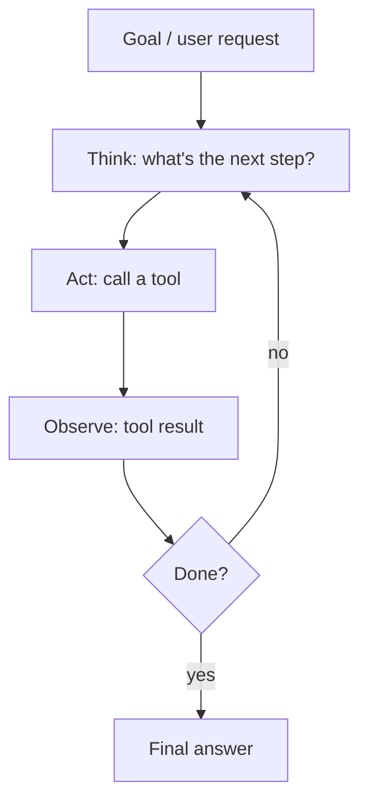

# Agents & Workflows

[⬅ Back to index](../README.md)

Covers: workflows vs agents, workflow patterns (chaining, routing, parallelisation, orchestrator-workers, evaluator-optimizer), when to build an agent, the agent loop, planning, memory, environment feedback, subagents, agent skills, human-in-the-loop, multi-agent systems, long-running agents, evaluation, failures, security, cost, and frameworks.

---

### 1. What is an AI agent?

Answer

An LLM-driven system that pursues a goal by **deciding its own steps**: it reasons about the task, calls **tools** (search, APIs, code execution, databases, other software), observes the results, and repeats until done. The key difference from a fixed pipeline is that the **model controls the control flow**. Components: a model, tools, instructions, memory/state, and an orchestration loop with limits and guardrails.

### 2. Workflows vs agents – when should you use each?

Answer

- **Workflows** – LLM calls orchestrated through **predefined code paths** (prompt chains, routing, parallel calls, evaluator loops). Predictable, testable, cheaper.
- **Agents** – the LLM dynamically chooses steps and tools. Flexible for open-ended tasks where steps can't be predicted (research, coding, complex support cases), but slower, costlier and harder to make reliable.

Start with the **simplest thing that works** (a single call with good retrieval and tools, then a workflow); add agentic autonomy only where the task genuinely needs it.

### 3. What are the common workflow patterns?

Answer

Patterns described in Anthropic's "Building effective agents" guidance:
- **Prompt chaining** – fixed sequence of LLM calls, each using the previous output, with checks between steps (outline → check → draft → translate).
- **Routing** – classify the input, then send it to a specialised prompt, tool set or model (refund vs technical question vs sales; easy vs hard).
- **Parallelisation** – run independent sub-tasks at once (**sectioning**), or run the same task several times and combine (**voting**, e.g. multiple reviewers for code security).
- **Orchestrator-workers** – a central LLM breaks a task into sub-tasks it can't predict in advance, delegates to workers, and synthesises results.
- **Evaluator-optimizer** – one LLM generates, another evaluates against criteria and gives feedback, loop until good enough (translation, writing, code).

They're building blocks – combine them as needed, and add complexity only when it measurably helps.

### 4. When should you use routing and parallelisation?

Answer

- **Routing** when inputs fall into distinct categories that are better handled separately – different instructions, tools or models per category – and classification is accurate. It also saves cost (simple queries to a small model).
- **Parallelisation** when sub-tasks are independent (speed) or when multiple perspectives/attempts improve reliability (guardrail checks run alongside the main response, several reviewers, majority vote). Combine results in code or with a final LLM call.

### 5. How do you decide whether you actually need an agent?

Answer

Check four things:
- **Complexity** – is the task multi-step and hard to specify in advance?
- **Value** – does the outcome justify higher cost and latency?
- **Viability** – can the model actually do this kind of task well?
- **Cost of error** – can mistakes be caught and recovered from (tests, review, rollback)?

If any answer is "no", use a single call or a workflow. Agents fit open-ended tasks such as coding changes across a repository, research across many sources, or complex support cases with tools.

### 6. What is the ReAct pattern?

Answer

**Reason + Act**: the model alternates between **thoughts** (reasoning about what to do next), **actions** (tool calls) and **observations** (tool results) in a loop.

It grounds reasoning in real information and makes behaviour inspectable. Modern tool-calling APIs implement this loop natively. Always add a **maximum number of steps**, timeouts and budget limits.

### 7. Why is environment feedback so important for agents?

Answer

Agents get things right by **checking reality** at each step: tool results, test outcomes, compiler errors, query results, screenshots. An agent that writes code and runs the tests can fix its own mistakes; one that just writes code can't. Design agents so they can **observe the effects of their actions** and verify progress (run tests, re-read the file, query the database after a write) before declaring success.

### 8. What principles make agents work well in practice?

Answer

- **Simplicity** – the simplest design that works; avoid unnecessary layers.
- **Transparency** – show the agent's plan and steps, so users and developers can follow and correct it.
- **Good tool design ("agent-computer interface")** – clear tool descriptions, examples, poka-yoke arguments (hard to misuse), helpful errors; test how the model actually uses the tools.
- **Ground truth at each step** from the environment.
- **Stopping conditions** – step limits, budgets, and clear criteria for "done".
- **Human checkpoints** where errors are costly.

### 9. How do agents plan?

Answer

- **Implicit step-by-step** – decide one action at a time (ReAct).
- **Plan-and-execute** – first write a plan (list of steps), then execute and revise the plan as results come in; good for long tasks and makes progress visible.
- **Decomposition into sub-tasks**, possibly delegated to sub-agents.
- **Reflection** – critique results and retry.
- **Search over options** (tree-of-thoughts style) for hard reasoning, at higher cost.

Reasoning models plan better internally, so explicit planning scaffolds matter less with them, but explicit plans still help with transparency and user approval.

### 10. How does memory work for agents?

Answer

- **Short-term / working memory** – the current context window: conversation, tool results, scratchpad. Must be managed (summarise or drop old tool outputs) for long tasks.
- **Long-term memory** – stored outside the model: facts about the user, past decisions, learned procedures, saved in a database or vector store and **retrieved when relevant**, or written to files the agent can read.
- **Episodic memory** – records of past task runs to learn from.

Design questions: what to store, when to write, how to retrieve, how to let users see and delete memories (privacy), and how to avoid storing wrong information.

### 11. What are subagents and when do you use them?

Answer

Separate agent instances, each with their **own context window, instructions and possibly a restricted tool set**, that the main agent delegates to – e.g. a "code reviewer" or "test runner" subagent in Claude Code. Benefits: context isolation (the main thread stays focused), specialisation (tailored prompts and tools), parallelism, and safer permissions (a reviewer subagent can be read-only). Use them for self-contained tasks that return a concise result; avoid them when steps depend tightly on each other.

### 12. What are agent skills?

Answer

**Skills** are folders containing instructions (a `SKILL.md` with a name and description), plus optional scripts and resources, that teach an agent how to do a specific kind of task – e.g. "create a slide deck in our brand", "run our release checklist", "analyse a spreadsheet". The agent sees only each skill's short description at first and **loads the full content only when the task needs it** (progressive disclosure), so many skills can be available without filling the context. Skills are reusable and shareable across a team, and work in Claude apps, Claude Code and via the API.

### 13. How do you design human-in-the-loop for agents?

Answer

- Classify actions by risk: **read-only** (run freely), **reversible** (allow with logging), **irreversible or external** (sending, paying, deleting, deploying – require approval).
- Show the user a clear summary of the proposed action and its effect before approval.
- Let users interrupt, correct and resume.
- Use permission modes (ask every time / allow-list / auto with safeguards) appropriate to the environment.
- Log decisions for audit.

### 14. What are multi-agent systems, and when are they worth it?

Answer

Several agents with different roles, prompts or tools collaborate: an **orchestrator** delegating to specialised **sub-agents** (researcher, coder, reviewer), agents running sub-tasks **in parallel**, or debate/critique setups.

Worth it when: tasks parallelise well (broad research across many sources), sub-tasks need different tools or isolated contexts, or a separate reviewer improves quality. Costs: many more tokens, coordination failures, harder debugging. Many tasks work better with a single well-equipped agent.

### 15. How do you build agents that run for hours?

Answer

- Give the **full task specification up front**, with clear success criteria.
- Have the agent maintain **progress files** (plan, status, notes) and commit work regularly so it can recover after context resets or crashes.
- Use **compaction** or fresh contexts that re-read state from files.
- Use tests and verification scripts the agent must pass.
- Set **budgets** (tokens, time, cost) and checkpoints for human review.
- Run in a sandbox with scoped credentials; monitor and allow interruption.
- Hosted options (e.g. managed agent platforms with per-session sandboxes) take care of the loop and infrastructure.

### 16. How do you evaluate agents?

Answer

- **Task success rate** on realistic benchmark tasks with automatic checks where possible (tests pass, correct database state, correct answer).
- **Trajectory evaluation** – were tool choices and arguments sensible? Any unsafe actions?
- **Efficiency** – steps, tokens, time and cost per task.
- **Robustness** – success over multiple runs (agents are non-deterministic; report pass rates, e.g. pass@k and pass^k), and with tool failures or ambiguous inputs.
- **Human review** of samples, plus production monitoring (escalations, user corrections).

Public benchmarks include SWE-bench (coding), WebArena/OSWorld (web and computer use), τ-bench (tool use with simulated users), GAIA (assistants).

### 17. Why do agents fail, and how do you make them more reliable?

Answer

Failure modes: compounding errors over many steps, wrong tool selection or arguments, getting stuck in loops, losing track of the goal as context grows, hallucinating tool results, and giving up or declaring success too early.

Reliability practices:
- Fewer, well-designed tools with clear descriptions and validated inputs.
- Step limits, timeouts and cost budgets; loop detection.
- Deterministic code for anything that doesn't need judgement (workflows inside agents).
- Verification steps (tests, checks against data) before declaring success.
- Context management (summaries, external memory, state files).
- Human-in-the-loop checkpoints for high-impact actions.
- Detailed tracing of every step for debugging.

### 18. What are the main security risks of agents?

Answer

- **Prompt injection** through anything the agent reads (web pages, emails, documents, tool results) – leading to data exfiltration or harmful actions.
- **Excessive permissions** – tools that can delete, pay or send without limits.
- **Data leakage** – combining access to private data, untrusted content and an outbound channel is especially dangerous.
- Supply-chain risk from third-party tools/MCP servers.

Mitigations: least-privilege, scoped credentials; sandboxed execution; allow-lists for domains and commands; human approval for sensitive actions; separating untrusted content from privileged actions; logging and anomaly detection; red-teaming.

### 19. How do you control the cost and latency of agents?

Answer

- Use smaller/faster models for routine steps and a strong model only for planning or hard decisions.
- Run independent tool calls **in parallel**.
- Trim tool outputs before adding them to the context; summarise history; use prompt caching for the stable prefix (system prompt + tool definitions).
- Cache tool results.
- Set step and token budgets; stop early when confident.
- Prefer deterministic workflows for predictable parts.

### 20. What are the options for building an agent on Claude?

Answer

- **Your own loop** on the Messages API with tool use – full control.
- **SDK tool runner** – the SDK runs the tool loop for tools you define.
- **Claude Agent SDK** – the Claude Code harness as a library: built-in file, shell and search tools, context management, subagents, hooks and permissions; you host it.
- **Managed agents** – Anthropic runs the loop and hosts a sandbox per session, with persisted agent configurations, skills and MCP.

Choose based on how much you want to own (infrastructure, loop logic) vs reuse. Frameworks from other vendors exist too; the trade-off is abstraction vs transparency.

---

[⬅ Previous: RAG & Agentic Search](10-rag-search.md) · [⬅ Back to index](../README.md) · [Next: AI Coding Assistants & Claude Code ➡](12-ai-coding-assistants.md)
