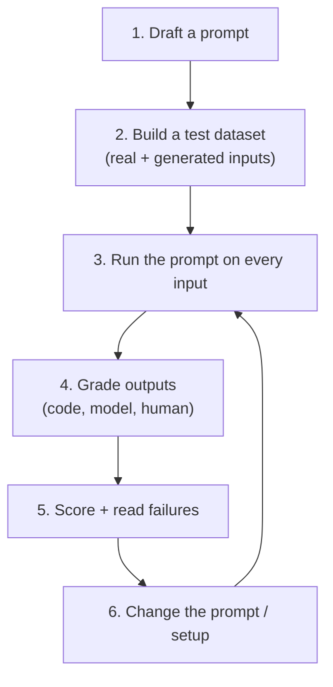

# Evals (Evaluating AI Features)

[⬅ Back to index](../README.md)

Covers: why evals matter, the eval workflow, building and generating test datasets, code-based, model-based and human grading, writing rubrics, LLM-as-judge pitfalls, evaluating RAG, tool use and agents, CI regression testing, online evaluation and monitoring, comparing prompts and models, and measuring hallucinations.

---

### 1. Why is evaluating LLM applications hard?

Answer

- Outputs are **open-ended**: many different answers can be correct.
- Outputs are **non-deterministic**: the same input can produce different results.
- Quality has many dimensions: correctness, faithfulness, helpfulness, tone, format, safety, latency, cost.
- Small prompt or model changes can fix one case and break others.
- Public benchmarks rarely reflect your specific task.

So teams need **task-specific evaluation sets**, several kinds of metrics, and continuous evaluation – "evals" are the LLM equivalent of unit and integration tests.

### 2. What does a typical prompt-eval workflow look like?

Answer

You compare scores between versions and keep the best, always re-running the full set so a fix for one case doesn't silently break others.

### 3. How do you build an evaluation set?

Answer

1. Start from **real user inputs** (logs, support tickets) plus hand-written cases; begin with 50–200 examples and grow over time.
2. Cover the distribution: common cases, **edge cases**, adversarial inputs, unanswerable questions, multiple languages if relevant.
3. Write **expected outputs or grading criteria** for each (a reference answer, required facts, a rubric, or a check function).
4. Tag examples by category so you can see where quality changes.
5. Every production bug becomes a new test case.
6. Keep it separate from anything used for few-shot examples or fine-tuning.

### 4. How do you generate a test dataset with an LLM?

Answer

Ask a model to produce **realistic, diverse inputs** for your task from a description: typical cases, edge cases, adversarial cases, different user types and styles – often as JSON so they're easy to load. Then **review and edit** them (generated data can be repetitive or unrealistic), add real examples from logs, and label expected outcomes or grading criteria. Generated datasets are a fast way to start; real data keeps them honest.

### 5. What kinds of automatic metrics are used?

Answer

- **Code-based checks** (cheapest and most reliable): exact match, JSON schema validity, regex, contains required fields, unit tests pass (code generation), SQL returns the right rows, numeric tolerance.
- **Reference-based text metrics**: BLEU/ROUGE (surface overlap), BERTScore (embedding similarity) – limited for open-ended answers.
- **Classifier-based**: toxicity, PII detection, language detection.
- **LLM-as-judge**: a model grades outputs against a rubric or reference.
- **Operational**: latency, tokens, cost, refusal rate, format-failure rate.

Prefer deterministic checks wherever possible; use LLM judges for qualities that need judgement.

### 6. Code-based vs model-based vs human grading – when to use each?

Answer

| Grader | Good for | Trade-offs |
|---|---|---|
| **Code-based** | Exact answers, formats, schema validity, keywords, numbers, tests passing, length | Fast, cheap, deterministic; can't judge nuance |
| **Model-based (LLM judge)** | Helpfulness, tone, faithfulness to sources, rubric criteria | Scales judgement; needs a precise rubric and calibration against humans; costs tokens |
| **Human** | Subjective quality, high-stakes domains, calibrating judges | Most reliable for nuance; slow and expensive |

Use code-based checks wherever possible and combine graders: e.g. code checks format, a model checks faithfulness, humans review a sample.

### 7. How do you write a good grading rubric?

Answer

- Break quality into **specific, independently checkable criteria** ("mentions the refund deadline", "doesn't promise anything not in the policy", "under 120 words").
- Prefer **pass/fail per criterion** or a small scale with defined anchors over a vague 1–10.
- Include examples of passing and failing answers.
- Ask the judge to give a short reason per criterion before the verdict.
- Test the rubric on examples where you know the right grade.

### 8. What is LLM-as-judge, and what are its pitfalls?

Answer

Using an LLM to evaluate outputs: **single-answer grading** (score against a rubric or reference) or **pairwise comparison** (which of two answers is better). It scales human-like judgement cheaply.

Known biases: **position bias** (prefers the first or second answer), **verbosity bias** (prefers longer answers), **self-preference** (prefers its own model family's style), and sensitivity to the judge prompt. Mitigations: precise rubrics with examples, binary or small scales, ask for reasoning before the verdict, swap positions and average, use a strong judge model, and **validate the judge against human labels** (measure agreement) before trusting it.

### 9. When do you need human evaluation?

Answer

For subjective qualities (tone, helpfulness, creativity), high-stakes domains (medical, legal, financial), calibrating LLM judges, and final checks before major launches. Make it reliable with clear guidelines, trained raters, multiple raters per item and inter-rater agreement measurement, and side-by-side comparisons (easier and more consistent than absolute scores).

### 10. How many test cases do you need?

Answer

Start small (20–50 well-chosen cases) to iterate fast, then grow to hundreds as the feature matures, adding every production failure. Coverage of **categories and edge cases** matters more than raw count. Remember small sets have large error bars: a change from 80% to 84% on 50 cases may be noise – look at which cases changed and use larger sets before big decisions.

### 11. How do you evaluate a RAG system specifically?

Answer

Separate components:
- **Retrieval** – recall@k, precision@k, MRR on questions labelled with relevant chunks.
- **Context relevance** – how much retrieved text is actually useful.
- **Faithfulness / groundedness** – every claim in the answer is supported by retrieved context (LLM judge or NLI model checks claims one by one).
- **Answer correctness and relevance** – against references or a rubric.
- **Citation accuracy** – cited sources really support the claims.
- **Abstention** – says "I don't know" on unanswerable questions.

See [RAG](10-rag-search.md).

### 12. How do you evaluate tool use and agents?

Answer

- **Outcome checks** – did the task succeed? Check the final state (database rows, files, tests passing) rather than only the text answer.
- **Tool-call checks** – correct tool chosen, valid arguments, no unnecessary or unsafe calls.
- **Efficiency** – steps, tokens, time and cost per task.
- **Robustness** – run each task several times (agents are non-deterministic) and report pass rates; include tool failures and ambiguous requests.
- **Transcripts** – read trajectories of failures to see where reasoning went wrong.

### 13. How do you run evaluations in a CI/CD pipeline?

Answer

- Store eval sets and grading code in the repository.
- On every change to prompts, models, retrieval settings or tools, run the eval suite (or a fast subset on each commit and the full set nightly).
- Compare against the current production baseline per category; **block the release on regressions** beyond a threshold.
- Run multiple samples per example for non-deterministic outputs and look at pass rates, not single runs.
- Track cost and latency alongside quality.
- Keep results and traces to inspect failures.

### 14. How do you evaluate LLM features in production (online)?

Answer

- **User signals** – thumbs up/down, edits to generated text, copy/accept rates, retries, abandonment, escalation to a human.
- **A/B tests** for prompt or model changes on business metrics.
- **Sampling + automatic grading** – run LLM judges or classifiers on a sample of live traffic (faithfulness, toxicity, format).
- **Monitoring** – latency, error rates, token usage and cost, refusal rates, drift in input topics.
- **Human review queues** for flagged conversations.

Feed failures back into the offline eval set.

### 15. How do you compare two models or prompts fairly?

Answer

Use the same eval set and grading; run multiple samples per input; report metrics per category with **confidence intervals** (small eval sets have large error bars); include cost and latency; use pairwise comparisons with position swapping for subjective quality; and check statistical significance before declaring a winner. Look at examples where they disagree – it's often more informative than the aggregate score.

### 16. How do you measure hallucination rate?

Answer

- For grounded tasks (RAG, summarisation): split answers into **atomic claims** and check each against the source documents (LLM judge or NLI model) – hallucination rate = unsupported claims ÷ total claims.
- For factual QA: questions with verified answers, scoring correct / incorrect / abstained separately (an "I don't know" is better than a wrong answer).
- Track citation validity.
- Sample human verification to calibrate the automated checks.

### 17. What are the well-known public benchmarks, and how much should you trust them?

Answer

Examples: **MMLU / MMLU-Pro** (knowledge across subjects), **GPQA** (hard science questions), **GSM8K / MATH / AIME** (maths), **HumanEval / LiveCodeBench / SWE-bench** (coding), **Chatbot Arena** (crowdsourced pairwise preferences), long-context and tool-use benchmarks, and newer very hard sets (e.g. Humanity's Last Exam).

Limitations: **contamination** (test questions leaked into training data), saturation (top models all score near the ceiling), and mismatch with your use case. Treat them as rough signals; decide using your own evals.

### 18. What is "vibe checking", and why is it not enough?

Answer

Trying a handful of prompts by hand and judging whether outputs "feel right". It's useful early for exploration, but it misses regressions, covers few cases, and is biased by recent examples. Mature teams move quickly to a systematic eval set, tracked metrics and automated runs – while still reading real outputs regularly, because metrics can miss issues.

### 19. What should you log and trace in an LLM application?

Answer

Per request: user/session IDs (pseudonymised), prompt template and version, model and parameters, full input context (or references to it), retrieved documents and scores, each tool call with arguments and results, outputs, latency per step, token counts and cost, errors, and user feedback. Use tracing tools (OpenTelemetry-based or LLM-specific platforms such as Langfuse, LangSmith, Arize Phoenix). Respect privacy: redact PII, set retention limits, restrict access.

### 20. How do you use evals to improve a prompt without overfitting?

Answer

Split your test set: iterate on a **development** set, and check final candidates on a **held-out** set you don't look at while tuning. If the dev score rises but the held-out score doesn't, you've fitted the prompt to specific examples. Also keep categories balanced, prefer general instructions over case-specific patches, and refresh the held-out set with new production examples over time.

### 21. How do you evaluate a multi-turn chatbot?

Answer

- **Scripted conversations** – fixed multi-turn test cases with checks at each turn (did it remember the order number from turn 1? did it ask for missing information?).
- **Simulated users** – an LLM plays a user with a goal and persona and talks to the bot; a grader judges whether the goal was achieved, how many turns it took, and whether policies were followed.
- **Conversation-level metrics** – task success, turns to resolution, escalations, policy violations, tone.
- **Production sampling** – grade a sample of real conversations automatically and review failures by hand.

### 22. Which metrics would you use to evaluate a summarisation feature?

Answer

- **Faithfulness** – no claims unsupported by the source (claim-by-claim check with an LLM judge or NLI).
- **Coverage** – includes the key points (compare against a list of must-include facts written by humans).
- **Conciseness and format** – length limits, required sections (code checks).
- **Usefulness for the audience** – rubric-based judge or human ratings.
- Older overlap metrics (ROUGE) correlate weakly with quality for modern abstractive summaries, so use them only as a rough signal.

---

[⬅ Previous: AI Coding Assistants & Claude Code](12-ai-coding-assistants.md) · [⬅ Back to index](../README.md) · [Next: Guardrails, Safety & Security ➡](14-guardrails-safety.md)
