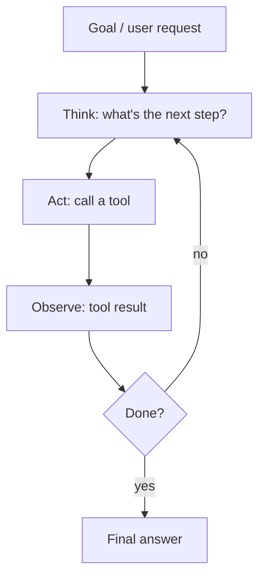

# Agents, Tool Use & MCP

[⬅ Back to index](../README.md)

Covers: what an AI agent is, workflows vs agents, function/tool calling, the ReAct loop, planning, memory, multi-agent systems, the Model Context Protocol (MCP), computer-use and browser agents, coding agents, agent evaluation, reliability and cost, and agent security.

---

### 1. What is an AI agent?

Answer

An LLM-driven system that pursues a goal by **deciding its own steps**: it reasons about the task, calls **tools** (search, APIs, code execution, databases, other software), observes the results, and repeats until done. The key difference from a fixed pipeline is that the **model controls the control flow**. Components: a model, tools, instructions, memory/state, and an orchestration loop with limits and guardrails.

### 2. Workflows vs agents – when should you use each?

Answer

- **Workflows** – LLM calls orchestrated through **predefined code paths** (prompt chains, routing, parallel calls, evaluator loops). Predictable, testable, cheaper.
- **Agents** – the LLM dynamically chooses steps and tools. Flexible for open-ended tasks where steps can't be predicted (research, coding, complex support cases), but slower, costlier and harder to make reliable.

Start with the **simplest thing that works** (a single call with good retrieval and tools, then a workflow); add agentic autonomy only where the task genuinely needs it.

### 3. How does function / tool calling work?

Answer

1. You describe tools to the model: name, description, and a **JSON schema** for arguments.
2. Given the conversation, the model may respond with a **tool call** (tool name + arguments) instead of text.
3. **Your code** executes the tool (the model never runs anything itself), then sends the result back as a tool-result message.
4. The model continues: calls more tools or produces the final answer.

Good practice: clear tool names and descriptions (they're prompts), small focused tools, validated arguments, helpful error messages returned to the model, and idempotent/safe tools where possible.

### 4. What is the ReAct pattern?

Answer

**Reason + Act**: the model alternates between **thoughts** (reasoning about what to do next), **actions** (tool calls) and **observations** (tool results) in a loop.

It grounds reasoning in real information and makes behaviour inspectable. Modern tool-calling APIs implement this loop natively. Always add a **maximum number of steps**, timeouts and budget limits.

### 5. How do agents plan?

Answer

- **Implicit step-by-step** – decide one action at a time (ReAct).
- **Plan-and-execute** – first write a plan (list of steps), then execute and revise the plan as results come in; good for long tasks and makes progress visible.
- **Decomposition into sub-tasks**, possibly delegated to sub-agents.
- **Reflection** – critique results and retry.
- **Search over options** (tree-of-thoughts style) for hard reasoning, at higher cost.

Reasoning models plan better internally, so explicit planning scaffolds matter less with them, but explicit plans still help with transparency and user approval.

### 6. How does memory work for agents?

Answer

- **Short-term / working memory** – the current context window: conversation, tool results, scratchpad. Must be managed (summarise or drop old tool outputs) for long tasks.
- **Long-term memory** – stored outside the model: facts about the user, past decisions, learned procedures, saved in a database or vector store and **retrieved when relevant**, or written to files the agent can read.
- **Episodic memory** – records of past task runs to learn from.

Design questions: what to store, when to write, how to retrieve, how to let users see and delete memories (privacy), and how to avoid storing wrong information.

### 7. What are multi-agent systems, and when are they worth it?

Answer

Several agents with different roles, prompts or tools collaborate: an **orchestrator** delegating to specialised **sub-agents** (researcher, coder, reviewer), agents running sub-tasks **in parallel**, or debate/critique setups.

Worth it when: tasks parallelise well (broad research across many sources), sub-tasks need different tools or isolated contexts, or a separate reviewer improves quality. Costs: many more tokens, coordination failures, harder debugging. Many tasks work better with a single well-equipped agent.

### 8. What is the Model Context Protocol (MCP)?

Answer

An open protocol (introduced by Anthropic in late 2024 and since adopted widely across AI tools) that standardises how AI applications connect to external **tools, data and prompts**. An **MCP server** exposes capabilities – **tools** (actions), **resources** (readable data) and **prompts** (templates) – and any **MCP client** (a chat app, IDE, agent framework) can use them. It solves the N × M integration problem: build a GitHub or database connector once and it works across many AI apps.

Security considerations: only connect trusted servers, scope permissions and credentials tightly, beware of tool descriptions or results containing prompt injection, and require user approval for sensitive actions.

### 9. What are computer-use and browser agents?

Answer

Agents that operate software through its **user interface**: they look at screenshots (or the browser's accessibility tree/DOM), then click, type and scroll like a person. Useful when no API exists (legacy apps, websites). Challenges: slower and more expensive than API calls, brittle to UI changes, error-prone on complex pages, and exposed to **prompt injection from page content**. Run them in sandboxes, restrict sites and actions, and require confirmation for purchases, sending messages or entering credentials.

### 10. How do coding agents work?

Answer

They combine an LLM with tools to **read and search the codebase, edit files, run commands and tests**, and iterate on failures – in an IDE, a terminal, or a cloud sandbox. Key ideas: good repository context (search, project instructions files), small verifiable steps, running tests/linters as feedback, and human review of diffs. Risks: plausible but wrong code, security issues, deleting or changing things unexpectedly – so use sandboxes, permissions for destructive commands, version control and code review.

### 11. How do you evaluate agents?

Answer

- **Task success rate** on realistic benchmark tasks with automatic checks where possible (tests pass, correct database state, correct answer).
- **Trajectory evaluation** – were tool choices and arguments sensible? Any unsafe actions?
- **Efficiency** – steps, tokens, time and cost per task.
- **Robustness** – success over multiple runs (agents are non-deterministic; report pass rates, e.g. pass@k and pass^k), and with tool failures or ambiguous inputs.
- **Human review** of samples, plus production monitoring (escalations, user corrections).

Public benchmarks include SWE-bench (coding), WebArena/OSWorld (web and computer use), τ-bench (tool use with simulated users), GAIA (assistants).

### 12. Why do agents fail, and how do you make them more reliable?

Answer

Failure modes: compounding errors over many steps, wrong tool selection or arguments, getting stuck in loops, losing track of the goal as context grows, hallucinating tool results, and giving up or declaring success too early.

Reliability practices:
- Fewer, well-designed tools with clear descriptions and validated inputs.
- Step limits, timeouts and cost budgets; loop detection.
- Deterministic code for anything that doesn't need judgement (workflows inside agents).
- Verification steps (tests, checks against data) before declaring success.
- Context management (summaries, external memory, state files).
- Human-in-the-loop checkpoints for high-impact actions.
- Detailed tracing of every step for debugging.

### 13. What are the main security risks of agents?

Answer

- **Prompt injection** through anything the agent reads (web pages, emails, documents, tool results) – leading to data exfiltration or harmful actions.
- **Excessive permissions** – tools that can delete, pay or send without limits.
- **Data leakage** – combining access to private data, untrusted content and an outbound channel is especially dangerous.
- Supply-chain risk from third-party tools/MCP servers.

Mitigations: least-privilege, scoped credentials; sandboxed execution; allow-lists for domains and commands; human approval for sensitive actions; separating untrusted content from privileged actions; logging and anomaly detection; red-teaming.

### 14. How do you control the cost and latency of agents?

Answer

- Use smaller/faster models for routine steps and a strong model only for planning or hard decisions.
- Run independent tool calls **in parallel**.
- Trim tool outputs before adding them to the context; summarise history; use prompt caching for the stable prefix (system prompt + tool definitions).
- Cache tool results.
- Set step and token budgets; stop early when confident.
- Prefer deterministic workflows for predictable parts.

### 15. Which agent frameworks exist, and do you need one?

Answer

Examples: LangGraph, LlamaIndex, CrewAI, AutoGen/Microsoft Agent Framework, OpenAI Agents SDK, Claude Agent SDK, Google ADK, plus durable workflow engines (Temporal) for long-running processes. They help with tool schemas, loops, state, memory, tracing and multi-agent orchestration. But a basic agent loop is a few dozen lines with a provider SDK; frameworks add abstraction that can hide prompts and make debugging harder. Many teams start with direct API calls and adopt a framework when they need its specific features (persistence, human-in-the-loop, graphs of steps).

---

[⬅ Previous: Fine-Tuning & Alignment](14-fine-tuning-alignment.md) · [⬅ Back to index](../README.md) · [Next: LLM Evaluation ➡](16-llm-evaluation.md)
