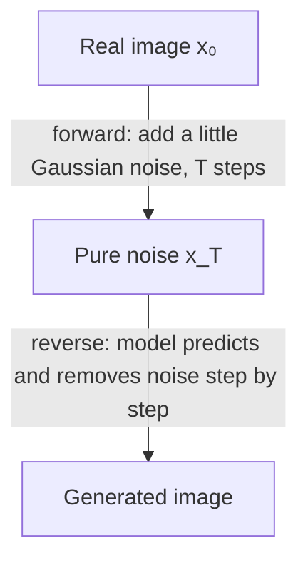

# Generative Models: VAEs, GANs & Diffusion

[⬅ Back to index](../README.md)

Covers: generative model families, VAEs, GANs and their training problems, diffusion models (forward and reverse process), latent diffusion and Stable Diffusion, classifier-free guidance, text conditioning, controlling generation (ControlNet, LoRA, inpainting), video and audio generation, evaluation (FID, CLIP score), and risks.

---

### 1. What are the main families of generative models?

Answer

- **Autoregressive models** – generate one element at a time, each conditioned on the previous ones (LLMs, some image/audio models).
- **VAEs** – encode into a probabilistic latent space and decode samples from it.
- **GANs** – a generator and a discriminator trained against each other.
- **Diffusion models** – learn to reverse a gradual noising process; state of the art for images, video and audio.
- **Flow-based models / flow matching** – learn invertible or continuous transformations from noise to data; flow matching is now widely used in image and video generators.

### 2. How does a variational autoencoder (VAE) work?

Answer

The encoder outputs a **distribution** (mean and variance) over latent variables instead of a single point; a sample from it (via the **reparameterisation trick** `z = μ + σ·ε`, so gradients can flow) is decoded back to the input. The loss = **reconstruction loss** + **KL divergence** pulling the latent distribution towards a standard normal. The smooth, organised latent space lets you **sample new data** and interpolate. VAE outputs tend to be blurry on their own, but VAEs are widely used as the **image compressor** in latent diffusion models.

### 3. How do GANs work, and why are they hard to train?

Answer

A **generator** turns random noise into fake samples; a **discriminator** tries to tell real from fake. They play a minimax game: the generator improves until the discriminator can't distinguish. GANs produce very sharp images (StyleGAN faces) and are fast at inference (one forward pass).

Training problems: **mode collapse** (the generator produces only a few kinds of outputs), instability/oscillation, vanishing gradients when the discriminator wins too easily, and hard-to-tune hyperparameters. Fixes include Wasserstein loss with gradient penalty, spectral normalisation and progressive growing. Diffusion models largely replaced GANs for general image generation thanks to stable training and better diversity.

### 4. How do diffusion models work?

Answer

- **Forward process** – gradually add Gaussian noise over many steps until the image is pure noise (fixed, no learning).
- **Training** – take a real image, add noise for a random step t, and train a network (a U-Net or a **diffusion transformer, DiT**) to **predict the noise** that was added (a simple MSE loss).
- **Generation** – start from random noise and repeatedly apply the model to denoise, step by step, until an image emerges.

Advantages: stable training, high quality and diversity. Disadvantage: slow sampling (many steps) – reduced by better samplers (DDIM, DPM-Solver), distillation into few-step models (consistency models, adversarial distillation) and flow matching.

### 5. What is latent diffusion (Stable Diffusion)?

Answer

Running diffusion on full-resolution pixels is very expensive. **Latent diffusion** first compresses images with a **VAE** into a much smaller latent representation (e.g. 8× smaller per side), runs the diffusion process in that latent space, then decodes the result back to pixels. A text encoder (CLIP or T5) provides the prompt embedding, injected through **cross-attention**. This made high-quality text-to-image generation feasible on consumer GPUs (Stable Diffusion) and is the basis of many image and video models.

### 6. What is classifier-free guidance?

Answer

During training, the text condition is randomly dropped some of the time, so the model learns both **conditional** and **unconditional** denoising. At generation, the model computes both predictions and extrapolates towards the conditional one: `ε = ε_uncond + w · (ε_cond − ε_uncond)`. The **guidance scale w** trades prompt adherence and image quality (higher w) against diversity and naturalness (lower w; too high gives oversaturated, artefact-heavy images). Negative prompts work by replacing the unconditional prediction with one conditioned on what to avoid.

### 7. How can you control or customise image generation?

Answer

- **Prompting** – detailed descriptions, styles, negative prompts.
- **Image-to-image** – start from a noised version of an input image instead of pure noise.
- **Inpainting / outpainting** – regenerate only a masked region or extend the canvas.
- **ControlNet / adapters** – condition on edges, depth maps, poses or sketches for structural control.
- **LoRA / DreamBooth / textual inversion** – fine-tune on a few images to learn a specific subject, product or style.
- **IP-Adapter** – condition on a reference image for style or identity.

### 8. How do video and audio generation models work at a high level?

Answer

- **Video** – diffusion or flow-matching transformers operating on **spatio-temporal latent patches** (compressed in both space and time), with text conditioning; the challenges are temporal consistency, motion realism, physics and enormous compute.
- **Audio / speech** – neural codecs turn audio into discrete tokens that autoregressive transformers can generate (text-to-speech, music), or diffusion operates on spectrograms/latents. Modern voice assistants use speech-native models for low-latency conversation.

### 9. How are generated images evaluated?

Answer

- **FID (Fréchet Inception Distance)** – compares feature statistics of generated and real images (lower is better); measures quality and diversity together, but needs many samples and doesn't check prompt adherence.
- **CLIP score** – similarity between the image and its prompt in CLIP space (prompt alignment).
- **Human preference** ratings and preference-trained scorers; arenas comparing models side by side.
- Task-specific checks: text rendering accuracy, counting, compositional prompts (benchmarks like GenEval).

### 10. What risks come with generative media models?

Answer

Deepfakes and impersonation, non-consensual imagery, misinformation, copyright and training-data consent questions, bias in depictions of people, and harmful content generation. Mitigations: training data filtering, prompt and output safety classifiers, refusing to generate real people in harmful contexts, **provenance** (C2PA content credentials, watermarking such as SynthID), usage policies and abuse monitoring.

### 11. Diffusion vs autoregressive generation for images – what's the trade-off?

Answer

- **Diffusion** – refines the whole image in parallel over steps; excellent quality; slower sampling without distillation; text-in-image and precise composition historically weaker.
- **Autoregressive** (images as token sequences, generated token by token, as in some natively multimodal LLMs) – unifies image generation with language models, good instruction following and text rendering, but many sequential steps for high resolution.

Recent systems mix ideas (autoregressive models with diffusion decoders, multimodal LLMs that output images).

---

[⬅ Previous: LLM Inference, Serving & Optimisation](17-llm-inference-serving.md) · [⬅ Back to index](../README.md) · [Next: MLOps & Production ML ➡](19-mlops-production.md)
