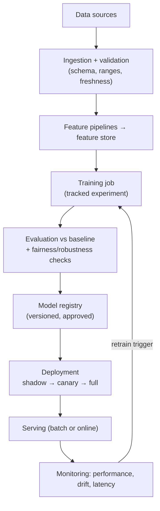

# MLOps & Production ML

[⬅ Back to index](../README.md)

Covers: the ML lifecycle in production, data and feature pipelines, feature stores, experiment tracking and model registries, training-serving skew, batch vs online inference, deployment strategies (shadow, canary, A/B), monitoring and drift, retraining, reproducibility, distributed training, LLMOps, and observability for LLM apps.

---

### 1. What is MLOps, and why is it needed?

Answer

MLOps applies DevOps practices to machine learning: automating and monitoring the path from data to deployed model and back. It's needed because ML systems depend on **data that changes**, not just code: models degrade silently, results must be reproducible, many experiments must be tracked, and training and serving pipelines must stay consistent. Most of the work in a production ML system is around the model (data pipelines, serving, monitoring), not the model code itself.

### 2. What does a production ML pipeline look like?

Answer

Each step is automated, versioned and observable.

### 3. What is a feature store?

Answer

A system that defines features once and serves them consistently for **training (offline store** – historical values in a warehouse/lake with **point-in-time correct** joins, so training never sees future data) and **serving (online store** – latest values in a low-latency KV store like Redis/DynamoDB). It prevents training-serving skew, enables feature reuse across teams, and handles freshness (batch and streaming feature pipelines). Examples: Feast, Tecton, Databricks/Vertex/SageMaker feature stores.

### 4. What is training-serving skew, and how do you prevent it?

Answer

When the model sees different data in production than in training: features computed with different code (SQL in training, Java in serving), different preprocessing, stale features online, or different default values. Symptoms: good offline metrics, bad online performance. Prevention: **one feature definition** for both paths (feature store), logging the features actually used at serving time and training on those logs, shared preprocessing code packaged with the model, and monitoring feature distributions online vs offline.

### 5. Batch inference vs online (real-time) inference?

Answer

- **Batch** – predictions computed periodically for all entities and stored (nightly recommendations, churn scores). Cheap, simple, can use big models; predictions can be stale; wasted on inactive users.
- **Online** – predictions computed per request with a latency budget (fraud check during payment, search ranking). Fresh features and context; needs low-latency serving, autoscaling and fallbacks.
- **Hybrid** – precompute candidates or embeddings in batch, rank online with fresh context.

### 6. How do you safely deploy a new model?

Answer

1. **Offline evaluation** against the current model on recent data, including slices (regions, user types).
2. **Shadow deployment** – the new model receives real traffic and logs predictions, but its outputs aren't used; compare with the live model and check latency.
3. **Canary** – serve a small percentage of traffic; watch business and system metrics; automatic rollback on regressions.
4. **A/B test** to measure the business impact with statistical rigour.
5. Full rollout, keeping the previous version ready for instant **rollback**.

### 7. What should you monitor for a production model?

Answer

- **System** – latency, throughput, error rates, resource use, cost.
- **Data quality** – missing values, schema changes, out-of-range values, upstream pipeline delays.
- **Data/prediction drift** – feature and prediction distributions vs training (PSI, KL divergence, KS tests).
- **Model performance** – accuracy/precision/recall etc. once labels arrive (often delayed: fraud chargebacks take weeks), or proxy metrics (click-through) meanwhile.
- **Business KPIs** and fairness metrics across groups.

Alert on meaningful changes and connect alerts to runbooks.

### 8. When and how should you retrain a model?

Answer

Triggers: a **schedule** (daily/weekly for fast-changing domains), **performance degradation** or **drift** detected by monitoring, new labelled data volume, or product changes. Process: automated pipeline with the same validation gates as the first deployment, comparison with the current model, and staged rollout. Consider online/incremental learning for very fast-changing problems (ads, news), and keep training data windows sensible (recent data vs enough history).

### 9. How do you make ML work reproducible?

Answer

Version **code** (Git), **data** (snapshots or data versioning tools like DVC/lakeFS, or immutable tables with time travel), **configuration and hyperparameters**, **environments** (containers, pinned dependencies), and **models** (registry with lineage back to data and code). Track experiments (MLflow, Weights & Biases) with metrics and artefacts. Set random seeds, while accepting that GPU non-determinism can cause tiny differences.

### 10. What is a model registry?

Answer

A central store of model versions with metadata: training data and code versions, metrics, owner, approval status, and stage (staging, production, archived). It supports governance (who approved what), reproducibility, comparison between versions, and automated deployment (CI/CD picks up the approved version). Examples: MLflow Model Registry, SageMaker/Vertex registries, Hugging Face Hub for internal models.

### 11. How is large-scale model training distributed?

Answer

- **Data parallelism** – each GPU has a full model copy and a different batch slice; gradients are averaged (all-reduce). Simple; limited by model size fitting on one GPU.
- **Sharded data parallelism (ZeRO / FSDP)** – shard optimiser states, gradients and weights across GPUs, gathering them when needed – trains models far larger than one GPU's memory.
- **Tensor parallelism** – split individual layers across GPUs.
- **Pipeline parallelism** – split layers into stages on different GPUs, with micro-batches to keep them busy.
- **Sequence/context parallelism** – split long sequences.

Large LLM training combines them ("3D/4D parallelism") with mixed precision, gradient checkpointing and fault-tolerant checkpointing (hardware failures are routine at thousands of GPUs).

### 12. What is LLMOps, and how is it different from classic MLOps?

Answer

LLMOps covers operating LLM-based applications:
- **Prompts as versioned artefacts**, with evaluation suites run on every change.
- **Model/provider management** – version pinning, upgrades, fallbacks, routing.
- **Evaluation** dominated by LLM-as-judge, human review and task-specific checks rather than single accuracy metrics.
- **Observability** of traces (prompts, retrieved context, tool calls, outputs), token usage and cost.
- **Guardrails** and safety monitoring.
- RAG index management (ingestion, re-embedding).
Less custom training in many cases, but more emphasis on evaluation, cost and safety.

### 13. What should you log and trace in an LLM application?

Answer

Per request: user/session IDs (pseudonymised), prompt template and version, model and parameters, full input context (or references to it), retrieved documents and scores, each tool call with arguments and results, outputs, latency per step, token counts and cost, errors, and user feedback. Use tracing tools (OpenTelemetry-based or LLM-specific platforms such as Langfuse, LangSmith, Arize Phoenix). Respect privacy: redact PII, set retention limits, restrict access.

### 14. How do you handle delayed labels in production?

Answer

Many outcomes are known only later (loan default after months, fraud chargebacks after weeks). Approaches: monitor **proxy metrics** and drift in the meantime; **join predictions with outcomes** when labels arrive and compute performance by prediction date; use early signals as weak labels; and design retraining windows that account for label maturity (don't train on recent examples whose labels aren't final yet – that biases towards "no fraud").

### 15. What is the difference between online learning and periodic retraining?

Answer

- **Periodic retraining** – train from scratch (or fine-tune) on a fresh data window at intervals; easier to validate and roll back.
- **Online learning** – update the model continuously with each new example or mini-batch (ads CTR models, news recommendations). Adapts fast to change, but risks instability and data poisoning, and needs strong monitoring and safeguards.

Many systems mix them: frequent incremental updates plus periodic full retrains.

### 16. How do you build a reliable data labelling pipeline?

Answer

- **Clear guidelines** with examples and edge cases; iterate them as disagreements reveal ambiguity.
- **Annotator quality control** – gold-standard questions, multiple labels per item for a sample, inter-annotator agreement, feedback to annotators.
- **Tooling** – a labelling platform with pre-labelling (model or LLM suggestions that humans correct), keyboard shortcuts, and audit trails.
- **Smart selection** – active learning to label the most useful examples; stratify to cover rare classes.
- **LLM-assisted labelling** – use strong LLMs for first-pass labels, with human review on samples and disagreements.
- **Versioned datasets** – track guideline versions and label changes; keep a clean, expert-labelled test set.
- Privacy controls when annotators see user data.

### 17. How are models packaged and served in production (ONNX, TorchServe, Triton)?

Answer

- **Formats** – native framework checkpoints, **ONNX** (portable format runnable with ONNX Runtime across hardware), TorchScript/`torch.export`, TensorRT engines (optimised for NVIDIA GPUs), Core ML / LiteRT for mobile.
- **Servers** – NVIDIA **Triton** (multi-framework, dynamic batching, model ensembles), TorchServe, TensorFlow Serving, KServe/Seldon on Kubernetes, BentoML; vLLM/SGLang/TGI for LLMs; managed endpoints (SageMaker, Vertex AI).
- **Key features** – dynamic batching, multiple model versions and canaries, GPU sharing, metrics, autoscaling, request validation.
- Simple models can be served inside a normal web service (FastAPI) – choose the simplest option that meets latency and throughput needs.

---

[⬅ Previous: Generative Models](18-generative-models.md) · [⬅ Back to index](../README.md) · [Next: ML & GenAI System Design ➡](20-ml-genai-system-design.md)
