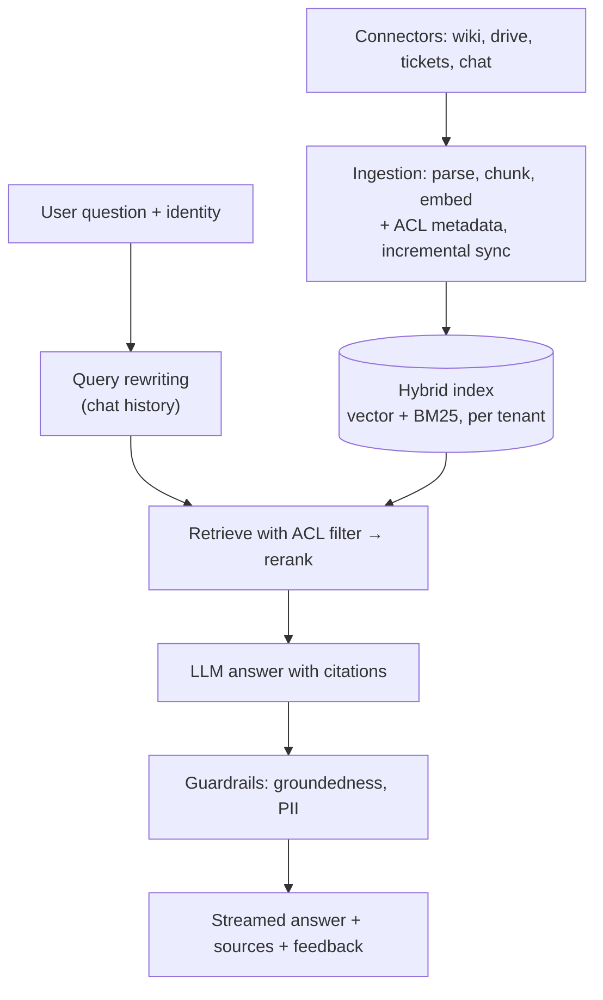

# AI System Design

[⬅ Back to index](../README.md)

Covers: a framework for designing AI features, then full designs: an enterprise RAG assistant, a customer-support agent, a coding assistant, an AI search engine, document extraction, a voice assistant, content moderation, an AI meeting summariser, an internal tool-using assistant, and an LLM gateway.

---

### 1. What framework should you use for an AI system design interview?

Answer

1. **Clarify** users, tasks, success metrics, scale, latency and cost budgets, risk level, data sensitivity.
2. **Choose the simplest approach** – single call, workflow, or agent – and justify it.
3. **Model choice** per step (capability vs cost/latency).
4. **Context** – prompts, retrieval, tools, memory; what goes into each call.
5. **Guardrails** – input/output checks, permissions, human review.
6. **Evaluation** – offline eval set and graders; online metrics.
7. **Operations** – caching, streaming, rate limits, fallbacks, monitoring, cost control, rollout.

### 2. Design an enterprise RAG assistant ("chat with company knowledge").

Answer

**Requirements** – answer employees' questions from wikis, docs, tickets and drives with citations; respect permissions; stay current; low hallucination.

**Deep dives** – permission-aware retrieval (never let the LLM see unauthorised content); parsing quality; freshness via change events; evaluation set from real questions (retrieval recall, faithfulness, answer correctness); cost (smaller models for rewriting/reranking); caching; analytics on unanswered questions to find documentation gaps. See [RAG](10-rag-search.md).

### 3. Design an AI customer-support agent.

Answer

- **Scope** – answer FAQs from the knowledge base (RAG), and perform actions through tools (check order status, start a refund, update an address) via the company's APIs.
- **Architecture** – intent/routing step → RAG for knowledge → tool-using agent with strict, scoped tools → policy checks in code (e.g. refunds above $X need approval) → **handoff to a human** with a summary when confidence is low, the user asks, or the topic is sensitive.
- **Safety** – the agent can't exceed what the user is entitled to; authenticate the user before account actions; prompt-injection defences; no invented policies (answers grounded in policy docs).
- **Evaluation** – simulated conversations with scripted users, resolution rate, correct tool calls, policy violations, CSAT, escalation rate, cost per resolved ticket.

### 4. Design an AI coding assistant (Copilot-style).

Answer

Two products with different constraints:
- **Inline completion** – very low latency (~100–300 ms): a small, fast code model; **fill-in-the-middle** prompts using code before and after the cursor; context from open files and nearby symbols; debounce keystrokes, cancel stale requests, cache; accept rate as the key metric.
- **Chat / agent mode** – a stronger model with **repository context**: code search (embeddings + symbol/keyword search), reading files, running tests and commands in a sandbox, editing multiple files, showing diffs for review.

Concerns: privacy of customer code (no training on it without consent, data retention), security (generated vulnerabilities, secret leakage, prompt injection from repository content), licence/IP filtering, and evaluation (unit-test pass rates, SWE-bench-style tasks, acceptance and retention of suggestions).

### 5. Design an AI search engine (Perplexity-style answer engine).

Answer

1. **Query understanding** – rewrite and decompose the question; decide if web search is needed.
2. **Retrieval** – call web search APIs or an own index for several sub-queries in parallel; fetch and parse top pages (cache popular pages).
3. **Extraction and ranking** – chunk pages, rerank passages for relevance and source quality, deduplicate.
4. **Generation** – an LLM writes an answer **with inline citations** to the passages; streamed to the user.
5. **Follow-ups** – conversational context; suggested related questions.

Challenges: latency (parallel fetching, fast rerankers, streaming), freshness, source reliability, citation accuracy (verify claims map to cited passages), cost per query, and handling prompt injection in fetched web pages.

### 6. Design an LLM-based document extraction pipeline (invoices, forms, KYC documents).

Answer

- **Ingestion** – documents arrive via upload/email/API; classify the document type.
- **Parsing** – OCR/layout extraction, or send page images directly to a **multimodal LLM**.
- **Extraction** – prompt the model with a **JSON schema** (structured outputs) for the fields (invoice number, dates, line items, totals), with instructions to return null rather than guess.
- **Validation** – deterministic checks: totals equal the sum of line items, dates valid, tax IDs match formats, cross-check against master data (vendor exists).
- **Confidence and review** – route low-confidence or failed-validation documents to **human review** in a UI that highlights the source region; reviewer corrections become evaluation and fine-tuning data.
- **Evaluation** – field-level accuracy per document type and vendor; track straight-through processing rate.
- **Cost/latency** – a small model for classification and simple documents, larger models for complex ones; batch processing; PII handling and retention limits.

### 7. Design a voice assistant feature (speech in, speech out).

Answer

**Pipeline option** – streaming ASR → LLM (with tools, e.g. calendar or order status) → streaming TTS. **Speech-native option** – one real-time multimodal model handling audio in and out, which reduces latency and preserves tone.

Key concerns:
- **Latency budget** – users expect replies within ~500–800 ms: stream everything, start TTS on the first sentence, use voice activity detection and smart endpointing (detect when the user finished speaking), allow **barge-in** (user interrupts – stop speaking immediately).
- **Robustness** – noise, accents, code-switching; confirm before high-impact actions ("Pay ₹500 to Ravi?").
- **Context** – conversation memory, user profile, device state.
- **Privacy** – wake-word detection on device; minimise audio retention; consent.
- **Evaluation** – word error rate, task success, latency percentiles, user satisfaction.

### 8. Design a content moderation system for a social platform.

Answer

- **Multi-layer pipeline** – hash matching against known violating content → fast ML classifiers per policy (text, image, video frames, audio) → LLM-based classifiers for nuanced policies → **human review** for uncertain or high-impact cases → appeals.
- **Timing** – pre-publication checks for high-risk surfaces; post-publication scanning; prioritise review by **severity × reach** (viral content first).
- **Models** – multimodal classifiers; LLMs prompted with the written policy (easy to update when policies change) and used to label data for cheaper classifiers.
- **Metrics** – precision/recall per policy, prevalence of violating content views, time to action, appeal overturn rate; fairness across languages and communities.
- **Feedback loop** – reviewer decisions become training data; adversarial evasion (misspellings, image text) requires continuous updates.

### 9. Design an AI meeting summariser.

Answer

- **Input** – meeting audio → transcription with speaker labels (diarisation); or platform transcripts.
- **Processing** – for long meetings, chunk the transcript by topic/time, summarise chunks, then combine (map-reduce), or use a long-context model with prompt caching.
- **Outputs** (structured): summary, decisions, **action items with owners and due dates**, open questions – as JSON validated by code, rendered in the UI.
- **Grounding** – link each action item to the transcript timestamp so users can verify.
- **Integrations** – create tasks in the tracker or send follow-up emails only after user confirmation.
- **Privacy** – consent from participants, retention limits, access only for attendees, PII handling.
- **Evals** – human-rated summaries on a set of meetings; action-item precision/recall against human notes.

### 10. Design an internal AI assistant that can use company tools (e.g. a Slack bot).

Answer

- **Entry** – chat interface (Slack/Teams) authenticates the employee; their identity flows to every tool call.
- **Knowledge** – RAG over wikis and docs with **permission-filtered** retrieval.
- **Actions** – tools/MCP servers for systems (tickets, calendar, HR FAQs, deployments) with least privilege and per-user authorisation; confirmation for writes.
- **Routing** – simple questions to a fast model, complex multi-step requests to a stronger model with an agent loop and step limits.
- **Guardrails** – prompt-injection defences (documents and tickets are untrusted), PII handling, audit logs.
- **Evals and feedback** – common question set, tool-call accuracy, user ratings; unanswered questions reveal documentation gaps.

### 11. Design an LLM gateway for a company.

Answer

A central service between all internal apps and model providers:
- **Unified API** across providers and models; routing and **fallback** when a provider is down or rate-limited.
- **Auth and quotas** per team/app; **cost tracking** and budgets; spend alerts.
- **Caching** (exact or semantic where safe) and retries with backoff.
- **Logging and tracing** with PII redaction and retention controls; prompt/version metadata.
- **Guardrails** – shared input/output moderation and data-loss prevention.
- **Policy** – which models are approved for which data classifications.

Trade-off: a central point of control and visibility vs an extra hop and a team to run it.

### 12. How do you handle the scale-up of an AI feature from prototype to production?

Answer

Prototype with a strong model and simple prompt → build an eval set → harden (structured outputs, validation, guardrails, error handling) → optimise (caching, model/effort per route, batching) → add observability (traces, cost, quality sampling) → staged rollout with feedback collection → continuous eval as prompts, data and models change.

---

[⬅ Previous: Responsible AI & Governance](19-responsible-ai-governance.md) · [⬅ Back to index](../README.md) · [Next: Scenario-Based Questions ➡](21-scenario-based.md)
