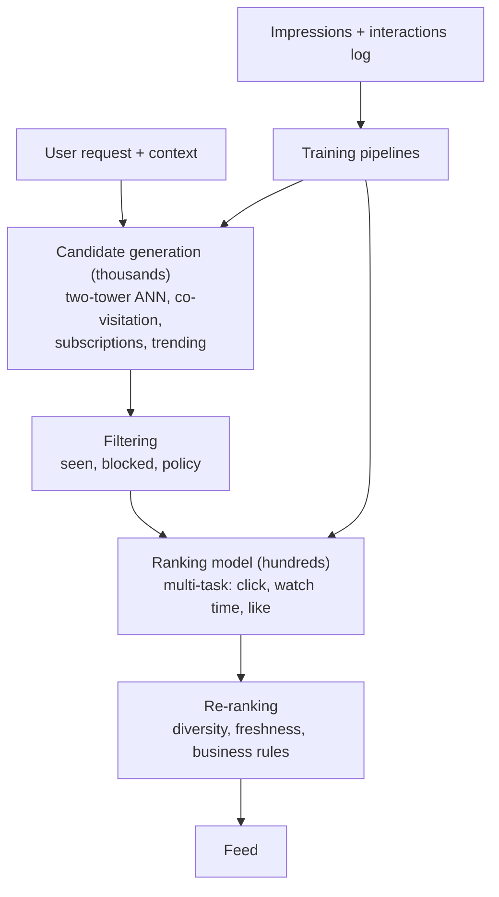
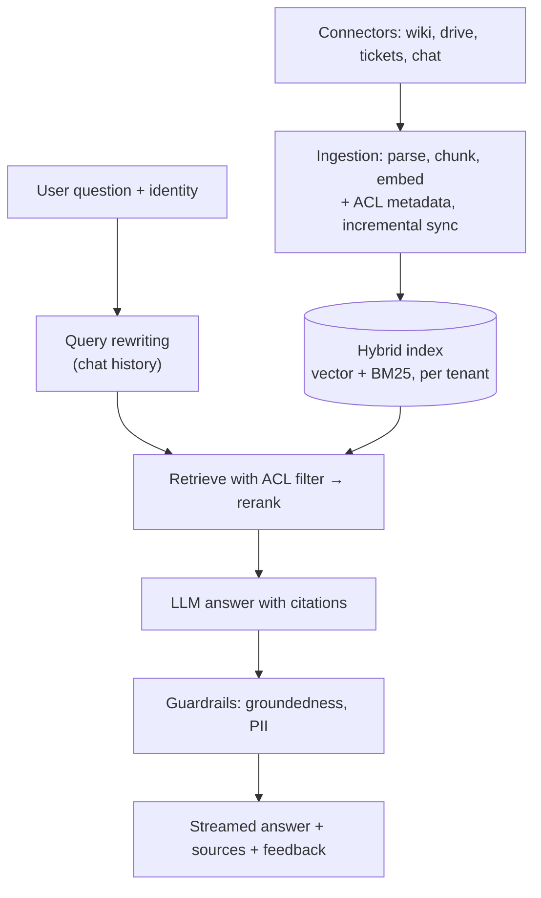

# ML & GenAI System Design

[⬅ Back to index](../README.md)

Covers: a framework for ML system design interviews, then full designs: recommendation system, search ranking, ads click-through prediction, fraud detection, content moderation, an enterprise RAG assistant, a ChatGPT-like service, a coding assistant, a customer-support AI agent, an AI search engine (Perplexity-style), and personalised notifications.

Each design follows: **goal & metrics → data → features/model → serving architecture → evaluation → monitoring & iteration**. For general backend design, see the [System Design repo](https://github.com/AkshayAshokCode/System-Design-Interview-Questions-cheat-sheet).

---

### 1. What framework should you use for an ML system design interview?

Answer

1. **Clarify the goal** – business objective, users, scale, latency budget, constraints (privacy, explainability).
2. **Define metrics** – offline (AUC, NDCG, precision@k) and online (engagement, revenue, retention) plus guardrails.
3. **Frame the ML task** – classification, ranking, generation; what exactly is predicted; label definition.
4. **Data** – sources, labels (explicit/implicit), sampling, imbalance, freshness, leakage, privacy.
5. **Features and model** – start with a baseline, then the main model; justify choices.
6. **Serving** – batch vs online, candidate generation + ranking, caching, latency.
7. **Evaluation** – offline then A/B tests.
8. **Monitoring and iteration** – drift, retraining, feedback loops, failure handling.

For LLM systems, replace "train a model" with **model choice, prompting, retrieval, tools, evaluation and guardrails**, and emphasise cost and latency.

### 2. Design a recommendation system (e.g. a video or product feed).

Answer

**Goal** – maximise long-term engagement/satisfaction, not just clicks. Metrics: offline recall@k, NDCG; online watch time, retention, diversity; guardrails for complaints and creator fairness.

**Key points**
- **Two-tower model** – user tower and item tower produce embeddings; item embeddings precomputed into an ANN index; retrieval = nearest items to the user embedding.
- **Ranking** – a deep model (or GBDT) using rich features: user history, item stats, context (time, device), cross features; **multi-task** heads combined into one score.
- **Data** – implicit feedback (clicks, watch time, skips); negative sampling; correct for **position bias**.
- **Cold start** – content-based embeddings for new items, onboarding and popularity for new users, **exploration** (bandits) to learn about new items.
- **Feedback loops** – the model only learns from what it showed; keep some exploration.
- **Serving** – latency budget ~100–200 ms; features from an online feature store; cache embeddings.

### 3. Design search ranking (e.g. e-commerce search).

Answer

**Pipeline** – query understanding (spell correction, synonyms, category/intent classification, query embedding) → **retrieval** (BM25 inverted index + vector search, merged) → **ranking** with a learning-to-rank model → business re-ranking (availability, diversity, sponsored slots).

**Ranking model** – features: text relevance scores, semantic similarity, product popularity, conversion rate, price, personalisation, freshness. Trained with **pairwise/listwise** losses (LambdaMART, neural rankers) on click and purchase logs (correct for position bias) and human relevance labels. Optionally a cross-encoder reranker for the top results.

**Metrics** – offline NDCG@10, MRR; online search conversion, click-through, zero-result rate, reformulation rate. **Latency** ~100–300 ms total.

### 4. Design an ad click-through rate (CTR) prediction system.

Answer

**Why it matters** – ad ranking ≈ `bid × predicted CTR (× conversion rate)`, so predictions must be **well calibrated**, not just well ranked.

- **Data** – billions of impressions with click labels; extreme imbalance (CTR ~1%); delayed conversions.
- **Features** – user (demographics, interests, history), ad (creative, advertiser, category), context (placement, device, time), and **cross features**; very high-cardinality IDs → embeddings / hashing.
- **Models** – logistic regression with feature crosses historically; now deep models (wide & deep, DeepFM, DCN, transformer-based sequence models over user history).
- **Training** – frequent or **online/incremental** updates because ads and user behaviour change fast; negative downsampling with **calibration correction**.
- **Metrics** – log loss, calibration, AUC offline; revenue, CTR, advertiser ROI online.
- **Serving** – thousands of ad candidates scored within tens of milliseconds; heavy feature caching.

### 5. Design a real-time fraud detection system for payments.

Answer

- **Goal** – block fraud while keeping false declines low; decisions within ~100 ms; metric: expected financial loss, precision at a target recall, approval rate.
- **Data** – transactions with labels from chargebacks/manual review (**delayed** and noisy); extreme imbalance.
- **Features** – transaction amount and merchant, **velocity features** (transactions per card/device/IP in the last minutes/hours, from streaming aggregations), device fingerprint, geolocation mismatch, account age, **graph features** (shared devices/cards across accounts).
- **Model** – rules engine for known patterns + GBDT model for risk score; graph neural networks or graph features for fraud rings; anomaly detection for new patterns.
- **Decision** – thresholds per segment: approve, decline, or **step-up** (3-D Secure / OTP), and manual review queues sized to reviewer capacity.
- **Ops** – adversarial drift (fraudsters adapt) → frequent retraining, monitoring, quick rule updates; explainability for reviewers and regulators.

### 6. Design a content moderation system for a social platform.

Answer

- **Multi-layer pipeline** – hash matching against known violating content → fast ML classifiers per policy (text, image, video frames, audio) → LLM-based classifiers for nuanced policies → **human review** for uncertain or high-impact cases → appeals.
- **Timing** – pre-publication checks for high-risk surfaces; post-publication scanning; prioritise review by **severity × reach** (viral content first).
- **Models** – multimodal classifiers; LLMs prompted with the written policy (easy to update when policies change) and used to label data for cheaper classifiers.
- **Metrics** – precision/recall per policy, prevalence of violating content views, time to action, appeal overturn rate; fairness across languages and communities.
- **Feedback loop** – reviewer decisions become training data; adversarial evasion (misspellings, image text) requires continuous updates.

### 7. Design an enterprise RAG assistant ("chat with company knowledge").

Answer

**Requirements** – answer employees' questions from wikis, docs, tickets and drives with citations; respect permissions; stay current; low hallucination.

**Deep dives** – permission-aware retrieval (never let the LLM see unauthorised content); parsing quality; freshness via change events; evaluation set from real questions (retrieval recall, faithfulness, answer correctness); cost (smaller models for rewriting/reranking); caching; analytics on unanswered questions to find documentation gaps. See [RAG](13-rag.md).

### 8. Design a ChatGPT-like conversational AI service.

Answer

- **Client ↔ API gateway** (auth, rate limits by requests and **tokens**, plans) ↔ **chat service** (loads conversation history, builds the prompt, applies moderation) ↔ **inference router** (picks model and cluster, queues by priority) ↔ **GPU inference fleet** (continuous batching, paged KV cache, prefix caching, speculative decoding).
- **Streaming** over SSE; cancellation frees GPU capacity.
- **Context management** – truncate/summarise long conversations; memory features retrieve saved user facts.
- **Tools** – web search, code execution, file analysis, image generation, executed in sandboxes.
- **Capacity** – GPUs are the bottleneck: admission control, priority tiers, graceful "at capacity" handling, multi-region scheduling.
- **Safety** – input/output moderation, abuse detection, policy enforcement.
- **Storage** – conversations sharded by user; titles/summaries generated asynchronously.
- **Metrics** – TTFT, tokens/s, error rate, cost per conversation, user ratings, retention.

### 9. Design an AI coding assistant (Copilot-style).

Answer

Two products with different constraints:
- **Inline completion** – very low latency (~100–300 ms): a small, fast code model; **fill-in-the-middle** prompts using code before and after the cursor; context from open files and nearby symbols; debounce keystrokes, cancel stale requests, cache; accept rate as the key metric.
- **Chat / agent mode** – a stronger model with **repository context**: code search (embeddings + symbol/keyword search), reading files, running tests and commands in a sandbox, editing multiple files, showing diffs for review.

Concerns: privacy of customer code (no training on it without consent, data retention), security (generated vulnerabilities, secret leakage, prompt injection from repository content), licence/IP filtering, and evaluation (unit-test pass rates, SWE-bench-style tasks, acceptance and retention of suggestions).

### 10. Design an AI customer-support agent.

Answer

- **Scope** – answer FAQs from the knowledge base (RAG), and perform actions through tools (check order status, start a refund, update an address) via the company's APIs.
- **Architecture** – intent/routing step → RAG for knowledge → tool-using agent with strict, scoped tools → policy checks in code (e.g. refunds above $X need approval) → **handoff to a human** with a summary when confidence is low, the user asks, or the topic is sensitive.
- **Safety** – the agent can't exceed what the user is entitled to; authenticate the user before account actions; prompt-injection defences; no invented policies (answers grounded in policy docs).
- **Evaluation** – simulated conversations with scripted users, resolution rate, correct tool calls, policy violations, CSAT, escalation rate, cost per resolved ticket.

### 11. Design an AI search engine (Perplexity-style answer engine).

Answer

1. **Query understanding** – rewrite and decompose the question; decide if web search is needed.
2. **Retrieval** – call web search APIs or an own index for several sub-queries in parallel; fetch and parse top pages (cache popular pages).
3. **Extraction and ranking** – chunk pages, rerank passages for relevance and source quality, deduplicate.
4. **Generation** – an LLM writes an answer **with inline citations** to the passages; streamed to the user.
5. **Follow-ups** – conversational context; suggested related questions.

Challenges: latency (parallel fetching, fast rerankers, streaming), freshness, source reliability, citation accuracy (verify claims map to cited passages), cost per query, and handling prompt injection in fetched web pages.

### 12. Design a system that decides when to send personalised push notifications.

Answer

- **Goal** – increase engagement without annoying users (track opt-outs and uninstalls as guardrails).
- **Candidates** – events worth notifying about (new content, price drops, messages).
- **Model** – predict the probability the user opens/acts **and** the probability of a negative outcome (disable notifications); choose by expected value; predict the best **send time** per user.
- **Constraints** – frequency caps, quiet hours, deduplication, priority of transactional over marketing.
- **Learning** – contextual bandits for exploring content/timing; A/B tests on long-term retention, not only open rate.
- **Optional GenAI** – personalised notification text generated by an LLM, with templates and safety review.

### 13. How do you handle the cold-start problem in recommendation systems?

Answer

- **New users** – popular/trending items by region and context, onboarding questions (choose interests), quick adaptation from the first few interactions (session-based models), demographic or device signals.
- **New items** – content-based features and embeddings (text, image, metadata) so they can be retrieved without interaction history; **exploration** budget (bandits) to collect early feedback; boosting fresh items.
- LLM-generated descriptions/embeddings can enrich sparse item metadata.

### 14. How do you choose between building a classic ML model and using an LLM for a task?

Answer

| Prefer classic ML (or a small fine-tuned model) | Prefer an LLM |
|---|---|
| Structured/tabular data, numeric prediction | Unstructured language, open-ended outputs |
| Very high volume, strict latency, low cost per prediction | Low/medium volume, flexible tasks, fast iteration |
| Plenty of labelled data | Little or no labelled data (zero/few-shot) |
| Needs calibrated probabilities / strict explainability | Needs reasoning, summarisation, generation |

A common pattern: use an LLM to prototype and to **label data**, then train a smaller model for production scale.

---

[⬅ Previous: MLOps & Production ML](19-mlops-production.md) · [⬅ Back to index](../README.md) · [Next: Responsible AI, Safety & Security ➡](21-responsible-ai-safety.md)
